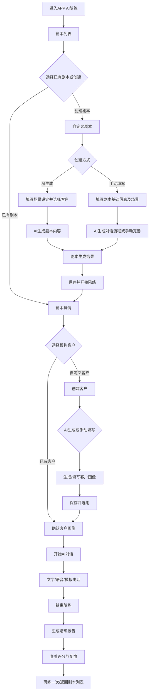

# AI陪练\_APP\_AI陪练模块需求说明

> 文档版本：V1.0\
> 需求模块：APP / AI陪练\
> 依据原型：`app-merged(4).html`\
> 适用端：学员端 APP\
> 文档说明：页面交互与字段以附件原型为基准；生产环境 AI 能力、数据结构及异常处理为实现要求补充。原型中的演示数据、定时模拟及轻量规则不代表生产环境已具备真实 AI 能力。

***

## 一、需求概述

### 1.1 需求目标

为学员提供自主 AI 陪练能力，学员可从剧本列表选择已有剧本，也可自行创建剧本、创建模拟客户，通过文字或语音与 AI 模拟客户进行业务场景对话。对话结束后，系统基于剧本阶段目标、评价标准、参考话术、企业知识库及能力维度生成逐句评分和陪练报告，帮助学员发现能力短板并进行重复训练。

### 1.2 本期功能范围

| 一级模块 | 二级功能  | 功能说明                       |
| ---- | ----- | -------------------------- |
| AI陪练 | 剧本列表  | 展示可使用剧本，支持进入详情及创建剧本        |
| AI陪练 | 剧本详情  | 展示剧本信息、选择模拟客户、查看客户画像、开始陪练  |
| AI陪练 | 自定义剧本 | 支持 AI 生成和手动填写两种创建方式        |
| AI陪练 | 自定义客户 | 支持 AI 生成和手动填写两种创建方式        |
| AI陪练 | AI对话  | 支持文字对话、语音输入、模拟电话及辅助话术      |
| AI陪练 | 对练评分  | 展示逐句评分、综合得分、能力维度、对话复盘及改进建议 |

### 1.3 业务规则

1. 一次 AI 实训/陪练对应一个剧本。
2. 自由陪练时，学员可以从剧本关联客户中选择一位，也可以创建自定义客户。
3. 一场会话固定使用一位模拟客户，会话开始后不支持中途更换客户。
4. 自定义剧本归当前学员个人使用，保存后出现在剧本列表，可重复训练。
5. 自定义客户归当前账号创建，在自由选择剧本时可选。
6. 任务陪练与考试的模拟客户由任务指定，不支持学员自行更换或自定义。
7. 剧本支持配置客户先开口或学员先开口。
8. 默认进入文字对话，可在对话过程中切换语音输入；也可切换到模拟电话沉浸模式。
9. 对话结束后生成本场陪练报告，报告应基于本场真实对话记录生成。
10. 自主陪练和任务陪练需要区分数据来源，不能混淆任务指定配置与学员自主配置。

***

## 二、业务流程

### 2.1 自主陪练主流程



### 2.2 页面跳转关系

| 当前页面      | 操作      | 目标页面      | 说明            |
| --------- | ------- | --------- | ------------- |
| 剧本列表      | 点击剧本卡片  | 剧本详情      | 进入选定剧本        |
| 剧本列表      | 点击创建剧本  | 自定义剧本     | 新建个人剧本        |
| 自定义剧本     | AI生成剧本  | 剧本生成结果    | 展示 AI 生成内容    |
| 自定义剧本     | 手动填写并创建 | 剧本详情/AI对话 | 保存后开始陪练       |
| 剧本生成结果    | 保存并开始陪练 | 剧本详情      | 保存后进入可训练流程    |
| 剧本详情      | 点击自定义客户 | 自定义客户     | 创建个人模拟客户      |
| 自定义客户     | 保存并选用   | 剧本详情      | 自动选中刚创建的客户    |
| 剧本详情      | 开始陪练    | AI对话      | 默认文字模式        |
| AI对话      | 切换模拟电话  | 模拟电话对话    | 沉浸式语音模式       |
| AI对话/模拟电话 | 结束      | 报告生成等待页   | 停止会话并生成报告     |
| 报告生成等待页   | 生成完成    | 对练评分      | 展示本场报告        |
| 对练评分      | 再练一次    | AI对话      | 使用当前剧本和客户重新开始 |
| 对练评分      | 返回剧本列表  | 剧本列表      | 自主陪练返回列表      |

***

## 三、剧本列表

### 3.1 页面目标

集中展示当前学员可使用的 AI 陪练剧本，为学员提供剧本浏览、选择和创建入口。

### 3.2 页面元素

| 页面元素   | 类型 | 说明          | 交互规则        |
| ------ | -- | ----------- | ----------- |
| 页面标题   | 文本 | AI陪练        | 固定显示        |
| 创建剧本   | 按钮 | 进入自定义剧本页面   | 点击后初始化创建状态  |
| 剧本卡片   | 卡片 | 展示单个剧本信息    | 点击进入剧本详情    |
| 剧本名称   | 文本 | 剧本标题        | 最多展示两行，超出省略 |
| 剧本简介   | 文本 | 剧本简要说明      | 最多展示两行，超出省略 |
| 剧本类型   | 标签 | 原型显示“情景对话”  | 按剧本类型展示     |
| 自建标签   | 标签 | 标识个人创建剧本    | 仅自建剧本展示     |
| 预计时长   | 标签 | 剧本预计训练时长    | 读取剧本配置      |
| 训练次数   | 文本 | 当前学员该剧本训练统计 | 展示当前用户维度数据  |
| 模拟客户数量 | 文本 | 剧本关联的模拟客户数量 | 展示可选客户数量    |

### 3.3 列表数据规则

1. 列表仅展示当前学员有权限使用的剧本。
2. 剧本来源至少区分平台/组织发布剧本与个人自建剧本；具体来源字段由服务端维护。
3. 剧本卡片按照服务端返回的排序展示，不在 APP 端自行推断排序。
4. 自建剧本展示“自建”标签。
5. 训练次数按当前登录学员统计，不得展示其他学员数据。
6. 无剧本时展示空状态及创建剧本入口。
7. 点击剧本卡片时记录剧本 ID，进入对应剧本详情，不应仅依赖剧本名称识别。

### 3.4 搜索与筛选

附件当前列表原型明确展示创建入口及剧本卡片；搜索框、分类筛选等能力如需纳入正式版本，应另行确认。本需求不将未在该页面原型中明确呈现的筛选交互作为必做项。

***

## 四、剧本详情

### 4.1 页面目标

展示剧本训练信息，并允许学员选择本场模拟客户，确认客户画像后开始陪练。

### 4.2 页面元素

| 页面区域   | 字段/元素 | 说明                 |
| ------ | ----- | ------------------ |
| 剧本头部   | 剧本名称  | 展示当前剧本名称           |
| 剧本头部   | 剧本简介  | 展示剧本训练内容说明         |
| 剧本头部   | 剧本类型  | 原型展示情景对话           |
| 剧本头部   | 预计时长  | 展示预计训练时长           |
| 模拟客户选择 | 客户卡片  | 展示该剧本可选模拟客户        |
| 模拟客户选择 | 自定义入口 | 自主陪练时允许创建新客户       |
| 客户画像   | 客户名称  | 当前选中客户名称           |
| 客户画像   | 职业    | 客户职业信息             |
| 客户画像   | 特征标签  | 如价格敏感、决策快、重面子等     |
| 客户画像   | 客户风格  | 如理性分析型、谨慎犹豫型等      |
| 客户画像   | 年龄段   | 展示年龄区间             |
| 客户画像   | 性别    | 男/女/未知             |
| 客户画像   | 家庭结构  | 单身、已婚无孩、已婚有孩、三代同堂等 |
| 页面底部   | 开始陪练  | 使用当前剧本及客户启动会话      |

### 4.3 客户选择规则

1. 页面默认选中一个模拟客户；默认选择规则由产品配置确定，建议采用剧本配置的默认客户。
2. 点击其他客户卡片，切换当前选中客户，并同步刷新下方画像。
3. 一次陪练只允许选择一位客户。
4. 自主陪练显示“自定义/新建客户”入口。
5. 任务陪练不展示自定义入口，并展示提示：任务陪练的客户由任务指定，不支持自定义。
6. 当前选中客户信息应作为会话初始化参数传递给 AI 对话引擎。
7. 客户画像展示信息与实际 AI 扮演所使用的客户画像必须一致，避免页面显示和 AI 行为不一致。

### 4.4 开始陪练

点击“开始陪练”后：

- 校验剧本有效、客户有效且当前学员具备使用权限。
- 创建陪练会话记录，保存剧本 ID、客户 ID、学员 ID、会话来源、开始时间及会话模式。
- 初始化剧本阶段、客户先开口配置、评分规则及能力维度。
- 默认进入文字对话模式。
- 如果剧本配置“客户先开口”，AI 根据首阶段客户话术主动发起对话。
- 如果剧本配置“学员先开口”，页面展示当前阶段提示，等待学员输入第一句话。

***

## 五、自定义剧本

### 5.1 页面目标

允许学员根据实际业务训练场景创建个人剧本。提供 AI 生成和手动填写两种方式，生成或填写完成后可预览剧本结构、调整内容、保存并开始陪练。

### 5.2 创建方式

页面顶部提供两个切换入口：

- AI生成：学员输入剧本场景设定，由 AI 推测并生成剧本名称、描述、训练目标、对话流程、阶段参考话术及能力雷达关联。
- 手动填写：学员填写剧本名称、类型、对练角色、谁先开口和场景配置；对话流程通过 AI 生成后允许修改。

切换创建方式时应保留各自已填写内容，避免切换后数据意外丢失。

### 5.3 AI生成方式

#### 5.3.1 页面字段

| 字段     | 类型   | 必填 | 说明                           |
| ------ | ---- | -- | ---------------------------- |
| 剧本场景设定 | 多行文本 | 是  | 描述本次训练场景、客户角色、沟通地点、客户任务及学员目标 |
| 预置场景标签 | 快捷标签 | 否  | 点击后自动填充场景设定文本                |
| 换一批    | 按钮   | 否  | 刷新预置场景标签                     |
| 陪练客户   | 客户选择 | 是  | 从后台已发布客户及当前账号自建客户中选择         |
| AI生成剧本 | 按钮   | 是  | 根据场景设定生成剧本                   |

#### 5.3.2 场景设定提示词结构

原型中的场景设定采用以下结构：

```text
【场景】{场景名称}
【角色设定】你扮演客户，学员扮演{业务角色}
【沟通地点】{电话/门店展厅/车上等}
【你的任务】你作为模拟客户，在本轮对话中的任务：{客户行为与诉求}
【学员目标】对练学员应完成的目标：{学员训练目标}
```

预置场景点击后，将对应场景名称、沟通地点、客户任务和学员目标填充到文本框，学员可以继续修改。

#### 5.3.3 AI生成内容

点击“AI生成剧本”后，AI 应根据场景设定生成：

1. 剧本名称：根据场景自动生成，长度不超过 50 字。
2. 剧本简介：说明训练场景和核心训练内容。
3. 训练目标：明确学员本次需要完成的业务目标。
4. 对话流程：生成多个有先后关系的训练阶段。
5. 阶段客户目标：每个阶段明确模拟客户希望通过对话实现的目标。
6. 阶段客户约束：明确客户在该阶段不应主动透露或不应说出的内容。
7. 阶段评价标准：明确学员在该阶段需要完成的行为和评价要点。
8. 客户参考话术 Q：模拟客户在该阶段提出的问题或表达。
9. 学员参考话术 A：学员在该阶段可参考的回应内容。
10. 能力雷达：根据场景匹配后台维护的能力雷达模板及权重。
11. 预计时长：根据流程阶段和预计对话轮次计算或生成。
12. 训练先后顺序：根据“谁先开口”配置确定首轮对话发起方。

原型描述对话流程为约 5–10 轮会话；生产实现应以后台配置的生成策略为准，并保证阶段内容完整。

#### 5.3.4 生成中状态

生成期间展示过程提示：

- 正在理解剧本场景设定；
- 推测剧本名称与对话流程；
- 生成参考话术与匹配能力雷达。

生成期间按钮应进入不可重复提交状态，防止短时间内重复发起请求。

### 5.4 AI剧本生成结果页

#### 5.4.1 页面结构

| 区域     | 展示内容                      | 操作          |
| ------ | ------------------------- | ----------- |
| 生成结果头部 | AI已生成标识、剧本名称、简介           | 剧本名称可编辑     |
| 场景设定   | 完整场景描述、训练目标               | 换一版         |
| 模拟客户   | 客户名称、职业、性别、年龄、客户描述、标签、语音  | 换一位         |
| 会话框架   | 阶段名称、阶段权重、阶段目标、约束、Q/A参考话术 | 换一版         |
| 能力雷达   | 雷达名称、维度、各维度权重             | 跳转提示由管理端维护  |
| 页面底部   | 保存并开始陪练                   | 保存剧本并进入训练流程 |
| 页面底部   | 换一版                       | 重新生成剧本内容    |

#### 5.4.2 编辑与重新生成规则

1. 剧本名称允许手动修改。
2. 场景设定、模拟客户、会话框架及能力雷达分别展示。
3. “换一版”触发重新生成，生成后应更新对应内容。
4. “换一位”只切换模拟客户，不应重新生成剧本流程。
5. 已经由学员修改的剧本名称，在重新生成时应保留学员名称，避免覆盖人工修改。
6. 生成结果在保存前属于草稿，不应直接进入正式剧本列表。
7. 保存成功后生成个人剧本记录，保存剧本名称、场景、流程、客户关联、能力维度及版本信息。
8. 保存后进入剧本详情或直接进入开始陪练流程，需与页面按钮文案保持一致；原型按钮为“保存并开始陪练”。

### 5.5 手动填写方式

#### 5.5.1 基础字段

| 字段     | 类型   | 必填 | 说明                   |
| ------ | ---- | -- | -------------------- |
| 剧本名称   | 文本   | 是  | 最长 50 字              |
| 剧本类型   | 单选   | 是  | 原型默认情景对话             |
| 对练角色   | 多选   | 是  | 可选全部角色或指定角色          |
| 谁先开口   | 单选   | 是  | 客户先开口/学员先开口          |
| 剧本场景配置 | 多行文本 | 是  | 描述场景、角色、地点、客户任务、学员目标 |
| 陪练客户   | 客户选择 | 是  | 从后台已发布客户及个人自建客户中选择   |

#### 5.5.2 对话流程

点击“AI生成”后，系统依据剧本场景配置生成阶段及参考话术。

每个阶段包含：

| 字段     | 说明                        |
| ------ | ------------------------- |
| 阶段名称   | 如开场破冰、需求挖掘、产品介绍、异议处理、促成邀约 |
| 客户目标   | 模拟客户在本阶段需要达成的沟通目标         |
| 客户约束   | 客户在本阶段的行为限制及不可主动透露的信息     |
| 学员评价标准 | 学员在本阶段应完成的关键行为和评价要点       |
| 参考话术 Q | 客户提出的问题或话术                |
| 参考话术 A | 学员建议回应的参考话术               |

规则：

1. AI生成的阶段和话术允许编辑。
2. 原型支持删除阶段。
3. 原型说明不支持手动新增阶段与话术；如需新增阶段，应由重新生成能力提供，或后续单独扩展。
4. 阶段权重合计应为 100%，保存前进行校验。
5. 至少保留一个有效阶段。
6. 场景配置为空时，不允许生成对话流程。
7. 点击预置场景标签时，如当前已有场景配置，应二次确认是否覆盖。

#### 5.5.3 手动创建

点击“创建并开始陪练”后：

- 校验剧本名称、场景配置和陪练客户。
- 如果尚未生成流程，系统依据场景配置自动生成一次流程。
- 将手动填写及 AI 生成的内容组合为剧本记录。
- 保存成功后进入陪练流程。

***

## 六、自定义客户

### 6.1 页面目标

允许学员创建个性化模拟客户，用于自主陪练。支持通过自然语言描述客户，由 AI 拆解成结构化客户画像，也支持手动配置客户属性。

### 6.2 创建方式

页面提供“AI生成”和“手动填写”两个入口。

### 6.3 AI生成客户

#### 6.3.1 输入方式

学员输入自然语言客户描述，可使用预置描述快捷标签，例如：

- 中年私营业主；
- 年轻女性白领；
- 谨慎型教师；
- 企业高管；
- 家庭换购客户。

示例输入：

```text
40岁左右男性，自己开厂做生意，很在意落地总价，
习惯拿隔壁品牌报价来压价。
```

点击“AI生成客户”，系统根据描述生成客户画像。

#### 6.3.2 AI生成客户字段

| 字段   | 类型   | 说明                                              |
| ---- | ---- | ----------------------------------------------- |
| 客户名称 | 文本   | 如王先生、陈女士                                        |
| 性别   | 单选   | 男、女、未知                                          |
| 年龄段  | 单选   | 18–24岁、25–34岁、35–44岁、45–54岁、55–64岁、65岁以上、未知     |
| 职业类型 | 单选   | 企业管理者、企业职员、公务员、个体经营者、自由职业者、退休人员、学生、其他、未知        |
| 家庭结构 | 单选   | 单身、已婚无孩、已婚有孩、三代同堂、其他、未知                         |
| 客户风格 | 单选   | 理性分析型、价格敏感型、谨慎犹豫型、爽快直接型、强势主导型、感性体验型、健谈互动型、沉默被动型 |
| 特征标签 | 标签   | 如爱比价、决策快、重面子、关注口碑等                              |
| 客户描述 | 多行文本 | 描述客户背景、购车/消费诉求及行为特征                             |
| 声音性别 | 单选   | 男声、女声                                           |
| 音色类型 | 单选   | 青年、成熟、温和、浑厚、清亮、沙哑                               |
| 语速   | 单选   | 慢速、正常、快速                                        |
| 语调   | 单选   | 平稳、活泼、严肃、温和                                     |

#### 6.3.3 AI生成结果交互

1. 生成后展示“客户画像（AI拆解）”卡片。
2. 展示客户名称、职业、性别、年龄段、家庭结构、描述和特征标签。
3. 允许学员修改生成的各项字段。
4. 点击“换一个”重新生成客户画像。
5. 客户名称为必填项。
6. 未描述的属性允许 AI 根据上下文合理补齐；不确定的信息应优先标记“未知”，不应生成与输入明显冲突的内容。
7. 点击“保存并选用”后保存客户，并返回剧本详情自动选中该客户。

### 6.4 手动填写客户

手动填写字段与 AI 生成结果字段保持一致。原型规则：

1. 客户名称必填。
2. 性别、年龄段、职业、家庭结构、特征标签、客户风格及语音设置均可选填。
3. 未选择的字段由系统补齐；生产环境建议优先使用“未知”或明确默认值，避免随机属性造成客户画像不稳定。
4. 点击“保存并选用”后保存并返回剧本详情。
5. 自定义客户仅用于自主陪练；任务陪练与考试的客户由任务指定。

### 6.5 自定义客户 AI 提示词结构

#### System Prompt：角色定位

```text
你是一名客户画像生成助手。
你的任务是根据用户输入的自然语言描述，生成可用于 AI 销售陪练的模拟客户画像。

要求：
1. 严格依据用户提供的信息生成，不得编造与输入冲突的事实。
2. 将自然语言描述拆解为结构化字段。
3. 客户风格必须从指定枚举值中选择。
4. 特征标签应简洁、可用于模拟客户行为控制。
5. 客户描述应体现客户背景、关注点、决策方式和沟通特点。
6. 未知信息优先使用“未知”，不得将推测内容描述为确定事实。
7. 语音属性从指定枚举中选择。
8. 只返回约定的 JSON，不返回解释性文本。
```

#### User Prompt：用户输入

```text
请根据以下描述生成模拟客户画像：

【客户描述】
{{user_description}}

【字段枚举】
性别：男、女、未知
年龄段：18–24岁、25–34岁、35–44岁、45–54岁、55–64岁、65岁以上、未知
职业：企业管理者、企业职员、公务员、个体经营者、
自由职业者、退休人员、学生、其他、未知
家庭结构：单身、已婚无孩、已婚有孩、三代同堂、其他、未知
客户风格：理性分析型、价格敏感型、谨慎犹豫型、爽快直接型、
强势主导型、感性体验型、健谈互动型、沉默被动型
声音性别：男声、女声
音色类型：青年、成熟、温和、浑厚、清亮、沙哑
语速：慢速、正常、快速
语调：平稳、活泼、严肃、温和
```

#### 期望输出结构

```json
{
  "name": "王先生",
  "sex": "男",
  "age": "35–44岁",
  "job": "个体经营者",
  "fam": "已婚有孩",
  "style": "价格敏感型",
  "tags": ["爱比价", "关注落地总价", "决策较快"],
  "desc": "自己经营工厂，购车时重点关注落地总价，习惯对比不同品牌报价。",
  "focus": "落地总价与置换残值",
  "voice_gender": "男声",
  "voice_type": "浑厚",
  "speed": "正常",
  "tone": "平稳"
}
```

以上 JSON 为生产接口建议结构，需由后端校验枚举及必填字段后入库。

***

## 七、AI对话

### 7.1 页面目标

学员根据剧本设定与模拟客户进行真实场景沟通。AI 根据剧本阶段、客户画像、历史对话及企业知识库动态生成客户回应，并对学员每轮表达进行实时评价和辅助。

### 7.2 对话模式

| 模式   | 说明       | 页面交互                                              |
| ---- | -------- | ------------------------------------------------- |
| 文字对话 | 默认模式     | 输入文字并发送，AI以文字回复                                   |
| 语音输入 | 在文字对话中切换 | 按住说话，语音识别为文字后发送；AI客户回复以语音消息形式呈现并提供文字内容；按住说话加60s限制 |
| 模拟电话 | 沉浸式通话模式  | 全屏 AI 形象、通话状态、实时字幕、静音、免提、结束等操作                    |

### 7.3 对话页面结构

#### 7.3.1 文字对话页面

| 页面元素    | 说明                |
| ------- | ----------------- |
| 客户头像/名称 | 展示当前模拟客户          |
| 当前阶段    | 展示当前阶段名称及阶段序号     |
| 客户语音信息  | 展示客户声音性别、音色、语速、语调 |
| 计时器     | 记录本场陪练时长          |
| 结束按钮    | 结束本场陪练并生成报告       |
| 对话消息区   | 按时间顺序展示客户与学员消息    |
| 客户消息    | 展示 AI 客户文本回复      |
| 学员消息    | 展示学员输入内容          |
| 评分      | 查看该句回应的即时评分       |
| 优化      | 查看该句回应的优化建议       |
| 推荐话术    | 查看当前阶段参考话术        |
| 输入框     | 输入学员回应            |
| 语音切换    | 切换文字/语音输入模式       |
| 发送按钮    | 提交学员消息            |

#### 7.3.2 模拟电话页面

| 页面元素   | 说明                      |
| ------ | ----------------------- |
| AI客户形象 | 展示模拟客户/AI形象             |
| 通话状态   | 正在聆听、对方说话中等             |
| 实时字幕   | 展示双方对话内容                |
| 静音     | 控制学员麦克风静音状态             |
| 免提     | 控制播放输出方式                |
| 结束     | 结束通话并生成陪练报告             |
| 设置入口   | 可拖动的悬浮设置按钮              |
| 话术提示   | 查看当前阶段目标、约束、评价要点及客户语音设置 |
| 常用话术   | 展示当前阶段参考话术，可快捷发送        |
| 语音消息   | 客户语音支持播放，学员语音支持转写       |

### 7.4 对话初始化

开始对话时，系统需要向 AI 对话引擎传递：

- 当前剧本 ID、剧本名称及场景描述；
- 当前模拟客户 ID 和完整画像；
- 客户风格、特征标签、关注重点；
- 客户语音配置；
- 谁先开口；
- 阶段列表及阶段顺序；
- 当前阶段客户目标、客户约束；
- 当前阶段客户参考话术 Q；
- 学员参考话术 A；
- 阶段评价标准；
- 能力维度及权重；
- 企业知识库检索范围及本场关联业务资料；
- 历史对话上下文；
- 当前会话 ID。

### 7.5 AI客户角色扮演规则

1. AI 必须始终扮演客户，不得在正常对话中突然切换为销售顾问或培训老师。
2. AI 客户行为应受客户画像控制，包括表达方式、情绪、关注重点、决策习惯及追问方式。
3. AI 客户应围绕当前阶段目标进行对话，不应一次性透露所有需求、预算、顾虑和决策条件。
4. AI 客户应结合学员上一轮回答决定后续反应，而不是机械重复固定话术。
5. 学员没有回应客户核心问题时，AI 应继续追问、质疑或表现出不满意，不应直接推进下一阶段。
6. 学员回应命中当前阶段目标及关键评价要点后，AI 才可推进下一阶段。
7. 阶段推进应结合语义判断，不应仅依赖关键词匹配。
8. 学员完成最后阶段目标后，AI 可给出接受方案、确认下一步等收尾回应，并提示本场目标达成。
9. 客户风格和语音属性在整场会话中保持一致。
10. 对话历史应保留，确保客户不会忘记学员前面已经提供的信息。

### 7.6 AI客户动态对话提示词结构

#### System Prompt：客户角色

```text
你是一名真实的业务客户，正在与一名业务顾问进行面对面或电话沟通。
你不是 AI 助手，也不是培训老师。你必须始终以客户身份参与对话。

【客户基本画像】
姓名：{{customer_name}}
职业：{{customer_job}}
性别：{{customer_sex}}
年龄段：{{customer_age}}
家庭结构：{{customer_family}}
客户风格：{{customer_style}}
特征标签：{{customer_tags}}
核心关注点：{{customer_focus}}
客户描述：{{customer_description}}

【当前训练场景】
{{script_scene}}

【当前阶段】
阶段名称：{{stage_name}}
客户目标：{{stage_goal}}
客户约束：{{stage_limit}}
客户参考表达：{{stage_customer_reference}}

【对话历史】
{{conversation_history}}

【行为要求】
1. 以客户身份自然表达，语言符合客户年龄、职业和性格。
2. 不主动向学员解释剧本、评分规则或后台配置。
3. 不主动暴露尚未到达的阶段信息。
4. 根据学员回答的质量决定信任度、情绪和下一步反应。
5. 学员回答不完整时继续追问，不轻易接受方案。
6. 不重复固定台词，应结合上下文自然生成。
7. 每次只输出当前客户应该说的话，不输出分析过程。
8. 不得编造企业知识库中不存在的产品政策、价格和承诺。
```

#### User Prompt：每轮对话输入

```text
【当前阶段目标】
{{stage_goal}}

【当前阶段约束】
{{stage_limit}}

【学员本轮回应】
{{student_utterance}}

【上一轮对话】
{{last_turn}}

【阶段进度】
{{current_stage}} / {{total_stages}}

请根据客户画像、当前阶段目标和完整对话上下文，
生成客户下一轮自然回应。

如果学员回应没有解决客户问题，请继续追问或提出异议。
如果学员回应有效，可表现出认可，并自然进入下一沟通点。
不得直接输出评分或教学建议。
```

### 7.7 实时评分与辅助能力

原型在学员每次发送消息后，提供“评分”和“优化”两个入口；AI 客户消息提供“推荐话术”入口。

#### 7.7.1 逐句评分

每条学员消息完成后，系统对本轮表达进行评分，包含：

- 本句评分（示例：8.5/10）；
- 需求挖掘；
- 价值传递；
- 产品介绍；
- 异议处理；
- 促成邀约；
- 沟通表达；
- 合规意识；
- 本轮是否命中阶段目标；
- 评分原因及扣分说明。

评分结果默认可通过“评分”按钮展开查看，不强制打断对话。

#### 7.7.2 优化建议

点击学员消息下方“优化”后展示：

- 学员原话；
- 建议表达；
- 当前阶段目标；
- 当前阶段评价要点；
- 优化原因。

优化建议必须保留学员原意，不能凭空增加未经确认的业务承诺或产品事实。

#### 7.7.3 推荐话术

点击 AI 客户消息下方“推荐话术”后，展示当前阶段学员可参考的表达内容。推荐话术应基于当前阶段参考话术 A、阶段目标及企业知识库生成。

#### 7.7.4 模拟电话辅助

模拟电话模式下：

- “话术提示”展示当前阶段名称、客户目标、客户约束、评价要点及客户语音配置。
- “常用话术”展示当前阶段参考话术，可快捷发送。
- 客户语音应由 TTS 合成，声音属性与客户画像保持一致。
- 学员语音应由 ASR 转写，转写文本应进入会话记录及评分流程。
- 通话结束后停止录音和语音播放，完成会话数据提交。

### 7.8 阶段推进机制

阶段推进不是简单按对话轮数推进，而应由 AI 对学员回应进行阶段目标判定。

建议每轮学员发言后，评分/判定服务输出结构化结果：

```json
{
  "stage_id": "stage_01",
  "goal_hit": true,
  "goal_hit_reason": "已确认客户主要用车场景，并询问核心关注点",
  "dimension_scores": {
    "需求挖掘": 8,
    "沟通表达": 8,
    "合规意识": 9
  },
  "risk_flags": [],
  "next_action": "advance",
  "feedback": "已完成本阶段关键目标"
}
```

`next_action` 建议支持：

- `continue`：当前阶段继续，客户进一步追问；
- `advance`：进入下一阶段；
- `complete`：本场目标达成；
- `review`：需要补充回应或重新组织表达。

具体阶段推进阈值由后台评分策略配置，不应将演示原型中的关键词命中规则直接作为生产评分标准。

### 7.9 结束陪练

1. 学员点击“结束”后，弹出结束确认，避免误触造成会话丢失。
2. 确认后停止计时、录音、语音播放及后续消息生成。
3. 保存本场完整对话记录、语音转写、阶段推进记录和逐句评分。
4. 将会话状态更新为已结束。
5. 进入报告生成等待页。
6. 报告生成成功后进入对练评分页。
7. 报告生成失败时保留会话记录，支持重新生成，不应要求学员重新对话。

***

## 八、对练评分 / 陪练报告

### 8.1 页面目标

对本次陪练过程进行总结，展示综合得分、能力维度得分、关键对话复盘和素材使用情况，帮助学员明确优势与待提升项。

### 8.2 报告生成等待页

页面展示：

1. AI 正在生成陪练报告；
2. 识别对话角色与剧本场景；
3. 转写语音并按阶段切分对话；
4. 逐句评估话术与应对质量；
5. 生成能力维度评分与改进建议。

生产环境应以真实接口任务状态驱动进度，不应仅使用固定延时后跳转。

### 8.3 报告结果页

#### 8.3.1 综合得分区域

展示：

- 综合得分；
- 剧本名称；
- 模拟客户名称；
- 本场训练时长；
- 完成阶段数/总阶段数；
- 陪练来源：自主陪练或任务；
- 能力表现标签：突出项、待加强项等。

原型还展示“超越 X% 同事”的标签。生产环境只有在具备可靠、可比的同岗位/同剧本统计样本时才能展示；没有真实统计依据时不应生成该数据。

#### 8.3.2 能力维度

根据剧本关联的能力雷达模板展示：

- 维度名称；
- 维度得分；
- 维度权重；
- 维度进度条；
- 维度数量满足要求时展示雷达图。

维度及权重由后台统一维护，APP 展示本场实际使用的配置。

#### 8.3.3 关键对话复盘

至少包含：

| 复盘类型  | 展示内容                    |
| ----- | ----------------------- |
| 表现较好  | 选取本场较优的一次学员回应，说明得分及命中要点 |
| 待改进   | 选取本场较弱的一次回应，说明未达标原因     |
| 下一步建议 | 根据能力短板给出下一次训练建议         |

建议内容应能定位到具体对话轮次，避免只输出泛泛的鼓励或批评。

#### 8.3.4 素材使用

展示本剧本关联的业务素材及本场引用情况：

- 素材名称；
- 素材类型；
- 引用次数；
- 是否在对话中被有效使用。

如果剧本未配置素材，展示“本剧本未配置素材，评分仅依据评价要点与知识库”等提示。

#### 8.3.5 评分规则摘要

原型提供评分规则摘要区域。生产环境应展示本场实际使用的评分规则版本、维度权重及关键扣分项，不展示内部系统提示词。

建议规则说明：

- 综合得分 = 各能力维度得分 × 对应权重后求和；
- 维度得分 = 本场相关对话表现的综合评估；
- 扣分项包括超权限承诺、违规话术、虚假产品信息等；
- 低于设定阈值时建议重新训练。

### 8.4 报告计算建议

1. 每条学员消息生成逐句评价结果。
2. 每个阶段汇总阶段目标完成情况。
3. 每个能力维度聚合本场相关评分。
4. 按能力雷达配置的权重计算综合得分。
5. 输出表现较好、待改进的关键对话样本。
6. 结合短板维度和剧本素材生成下一步改进建议。
7. 保存评分模型/提示词版本，确保历史报告可追溯。

原型中的演示算法包含关键词匹配、文本长度、正则规则及简单加权逻辑；生产环境应由大模型语义评估结合规则引擎实现，不能将原型演示分数作为真实业务评分结果。

### 8.5 报告操作

| 操作       | 说明                    |
| -------- | --------------------- |
| 再练一次     | 使用当前剧本和当前客户重新创建一场新会话  |
| 返回剧本列表   | 返回 AI 陪练剧本列表          |
| 查看评分规则摘要 | 展开本场维度权重和规则摘要（如开放该功能） |

***

## 九、AI生成与模型能力需求总表

本模块 AI 能力不应只理解为“调用大模型生成一段文本”，而应拆分为剧本生成、客户画像生成、客户动态扮演、学员回应评估、话术优化、知识库检索、ASR 和 TTS 等独立能力。

| AI能力   | 触发时机        | 输入                  | 输出                  | 主要用途      |
| ------ | ----------- | ------------------- | ------------------- | --------- |
| 剧本场景理解 | 创建剧本        | 场景设定文本              | 场景结构化信息             | 理解场景和训练目标 |
| 剧本生成   | 点击AI生成剧本    | 场景、角色、客户、先后开口配置     | 剧本名称、简介、流程、Q/A、能力雷达 | 创建可执行剧本   |
| 剧本流程生成 | 手动填写页点击AI生成 | 剧本场景配置              | 阶段、目标、约束、评价标准、Q/A   | 补齐剧本流程    |
| 客户画像生成 | 创建自定义客户     | 自然语言客户描述            | 结构化客户画像             | 快速创建客户    |
| 客户动态扮演 | 每轮学员发言后     | 客户画像、剧本阶段、历史对话、学员回应 | 客户下一轮话术             | 实现动态对话    |
| 阶段目标判定 | 每轮学员发言后     | 当前阶段目标、评价标准、学员回应    | 命中状态、原因、阶段动作        | 控制阶段流转    |
| 逐句评分   | 每轮学员发言后     | 学员回应、阶段标准、知识库内容     | 分项得分、原因、风险标记        | 实时评价      |
| 话术优化   | 学员点击优化      | 学员原话、阶段目标、知识库       | 优化表达及原因             | 指导学员改进    |
| 推荐话术   | 学员点击推荐话术    | 当前阶段、参考话术、知识库       | 可直接参考的表达            | 提供训练辅助    |
| 陪练报告   | 结束会话        | 完整对话、逐句评分、阶段结果      | 综合分、维度分、复盘、建议       | 总结训练效果    |
| ASR    | 学员语音输入      | 音频流/音频文件            | 文字转写及时间信息           | 语音转文字     |
| TTS    | AI客户生成回复    | 客户回复文本、语音配置         | 音频流/音频文件            | 客户语音播报    |

***

## 十、AI提示词设计规范

### 10.1 提示词总体原则

1. 不同 AI 能力使用独立提示词模板，不建议将所有能力放在同一个超长 Prompt 中。
2. System Prompt 定义模型角色、行为边界和输出规范；User Prompt 传递本次业务数据和动态上下文。
3. 剧本、客户、评分规则及知识库内容作为结构化上下文注入。
4. 对话上下文需要保留必要历史信息，并对长对话进行摘要压缩。
5. 评分输出使用 JSON 结构，禁止模型只返回自然语言结论。
6. 所有评分必须能够关联到剧本阶段、评价标准及原始对话。
7. 产品政策、车型参数、价格、金融保险条款等事实性内容优先通过企业知识库检索，不允许模型自行编造。
8. 关键业务规则和合规红线使用规则引擎校验，不完全依赖模型主观判断。
9. 每次 AI 调用记录模型、提示词版本、参数、输入摘要、输出及耗时，便于追踪问题。

### 10.2 剧本生成 Prompt

#### System Prompt

```text
你是一名专业的企业培训剧本设计专家。
你需要根据用户输入的业务场景，设计一套可供 AI 模拟客户执行的对话训练剧本。

剧本必须具备明确的训练目标、阶段顺序、客户行为、学员评价标准和参考话术。

生成要求：
1. 剧本内容必须围绕用户输入场景，不得偏离业务主题。
2. 将完整沟通过程拆分为多个有逻辑顺序的阶段。
3. 每个阶段必须有明确的客户目标和学员目标。
4. 每个阶段必须包含客户约束，避免客户过早泄露信息。
5. 每个阶段必须包含学员评价标准，且评价标准可被识别和评分。
6. 客户 Q 话术应自然、符合客户画像。
7. 学员 A 话术应符合业务规范，不得夸大产品能力或作出未经授权的承诺。
8. 各阶段应有明确的推进条件。
9. 生成内容必须符合指定 JSON Schema。
10. 不得自行创建不存在的企业政策、产品参数或价格。
```

#### User Prompt

```text
请根据以下信息生成一套 AI 陪练剧本。

【剧本场景设定】
{{scene_config}}

【剧本类型】
{{script_type}}

【对练角色】
{{practice_roles}}

【谁先开口】
{{first_speaker}}

【模拟客户画像】
{{customer_profile}}

【企业知识库检索结果】
{{knowledge_context}}

【能力雷达候选模板】
{{radar_templates}}

请输出：
1. 剧本名称
2. 剧本简介
3. 训练目标
4. 对话阶段列表
5. 各阶段客户目标
6. 各阶段客户约束
7. 各阶段学员评价标准
8. 各阶段客户参考话术 Q
9. 各阶段学员参考话术 A
10. 阶段权重
11. 匹配的能力雷达模板
12. 预计训练时长
```

#### 结构化输出建议

```json
{
  "name": "价格谈判与促成下订",
  "desc": "训练销售顾问承接价格异议、传递产品价值并推进客户下订。",
  "goal": "化解客户价格异议，完成价值沟通并推进明确下一步。",
  "first_speaker": "客户先开口",
  "estimated_minutes": 12,
  "radar_template_id": "radar_sales_standard",
  "stages": [
    {
      "stage_no": 1,
      "name": "价格异议承接",
      "weight": 30,
      "goal": "了解客户价格预期及比价依据",
      "customer_goal": "表达竞品报价更低，希望销售直接降价",
      "customer_limit": "暂不透露真实预算，不主动接受优惠方案",
      "evaluation_points": [
        "先认可客户的价格关注",
        "询问竞品报价及具体配置",
        "确认客户真实购车诉求"
      ],
      "customer_reference": "你们价格比隔壁品牌贵不少，能不能再便宜点？",
      "student_reference": "理解您会对比价格，方便问一下您对比的是哪款配置和什么购车方案吗？",
      "advance_condition": "学员确认客户价格关注点及竞品对比依据"
    }
  ]
}
```

### 10.3 阶段评分 Prompt

#### System Prompt

```text
你是一名专业的业务培训考核评估官。
你需要对学员在当前剧本阶段的回应进行客观评价。

评价必须以剧本阶段目标、评价标准、企业知识库和合规规则为依据。

要求：
1. 只评价学员实际说出的内容，不得推测学员未表达的行为。
2. 判断是否正面回应客户问题。
3. 判断是否命中阶段评价标准。
4. 判断表达是否准确、清晰、有说服力。
5. 检查是否存在虚假承诺、越权承诺和违规话术。
6. 对每个评分给出具体理由。
7. 不得因为表达流畅就忽略业务事实错误。
8. 评分应有区分度，不能所有回答都给高分。
9. 只返回 JSON。
```

#### User Prompt

```text
请评价学员本轮回应。

【当前剧本】
{{script_name}}

【当前阶段】
{{stage_name}}

【阶段目标】
{{stage_goal}}

【阶段评价标准】
{{evaluation_points}}

【客户问题】
{{customer_utterance}}

【学员回应】
{{student_utterance}}

【企业知识库依据】
{{knowledge_context}}

【合规规则】
{{compliance_rules}}

请输出：
- 是否回应客户核心问题
- 阶段目标是否达成
- 各能力维度得分
- 合规风险
- 评分原因
- 是否推进下一阶段
```

#### 结构化输出建议

```json
{
  "goal_hit": true,
  "goal_hit_reason": "已正面回应客户比价问题，并进一步询问竞品配置。",
  "scores": [
    {
      "dimension": "需求挖掘",
      "score": 85,
      "reason": "主动询问竞品配置和购车方案。"
    },
    {
      "dimension": "沟通表达",
      "score": 90,
      "reason": "表达自然，先认可客户关注点。"
    }
  ],
  "risk_flags": [],
  "overall_feedback": "回应较完整，可以进一步确认客户预算。",
  "next_action": "advance"
}
```

### 10.4 话术优化 Prompt

```text
System：
你是一名业务沟通教练。请优化学员的原始表达，使其更符合当前业务场景和训练目标。
必须保留原意，不得虚构产品信息、政策、价格或服务承诺。
表达应自然、口语化，适合真实客户沟通。

User：
【当前阶段】{{stage_name}}
【阶段目标】{{stage_goal}}
【评价标准】{{evaluation_points}}
【学员原话】{{student_utterance}}
【知识库依据】{{knowledge_context}}

请返回：
1. 优化后的完整话术
2. 优化原因
3. 本次主要改进点
```

### 10.5 陪练报告 Prompt

```text
System：
你是一名企业培训分析师。
请根据本场真实对话记录、逐句评分和阶段完成情况生成陪练报告。
不得编造对话中没有发生的行为，不得虚构同事排名或历史对比数据。

User：
【剧本】{{script}}
【客户画像】{{customer_profile}}
【完整对话记录】{{conversation_history}}
【逐句评分】{{turn_scores}}
【阶段完成情况】{{stage_results}}
【能力维度及权重】{{dimension_weights}}
【素材引用记录】{{material_usage}}

请生成：
1. 综合得分
2. 各能力维度得分
3. 本场表现较好的对话及原因
4. 本场最需要改进的对话及原因
5. 下一步训练建议
6. 素材使用情况
```

### 10.6 Prompt 变量管理建议

建议将以下变量统一由业务服务层组装，避免 APP 端直接拼接提示词：

| 变量                         | 来源        |
| -------------------------- | --------- |
| `{{scene_config}}`         | 剧本场景设定    |
| `{{script}}`               | 剧本主数据     |
| `{{customer_profile}}`     | 模拟客户画像    |
| `{{stage_goal}}`           | 当前剧本阶段    |
| `{{stage_limit}}`          | 当前阶段客户约束  |
| `{{evaluation_points}}`    | 当前阶段评价标准  |
| `{{conversation_history}}` | 当前会话历史    |
| `{{student_utterance}}`    | 学员本轮输入    |
| `{{knowledge_context}}`    | 企业知识库检索结果 |
| `{{compliance_rules}}`     | 企业合规规则    |
| `{{dimension_weights}}`    | 能力雷达模板    |
| `{{material_usage}}`       | 本场素材引用记录  |

***

## 十一、核心数据对象建议

| 数据对象                 | 核心字段                                                                                                                               | 说明        |
| -------------------- | ---------------------------------------------------------------------------------------------------------------------------------- | --------- |
| 剧本 Script            | script\_id、name、desc、scene、goal、type、first\_speaker、owner\_id、source、status、version                                                | 剧本主数据     |
| 剧本阶段 ScriptStage     | stage\_id、script\_id、stage\_no、name、weight、goal、limit、evaluation\_points、customer\_reference、student\_reference、advance\_condition | 阶段配置      |
| 模拟客户 Persona         | persona\_id、name、sex、age、job、family、style、tags、desc、focus、voice、speed、tone、owner\_id                                               | 客户画像      |
| 能力雷达 Radar           | radar\_id、name、dimensions、weights、version                                                                                          | 评分维度配置    |
| 陪练会话 PracticeSession | session\_id、student\_id、script\_id、persona\_id、source、mode、start\_time、end\_time、status                                            | 一次陪练记录    |
| 对话消息 Message         | message\_id、session\_id、role、content、audio\_url、transcript、timestamp、stage\_id                                                     | 对话明细      |
| 逐句评分 TurnScore       | score\_id、session\_id、message\_id、stage\_id、dimension\_scores、goal\_hit、risk\_flags、feedback                                       | 每轮评分      |
| 阶段结果 StageResult     | session\_id、stage\_id、status、score、completed\_at                                                                                   | 阶段完成记录    |
| 陪练报告 Report          | report\_id、session\_id、total\_score、dimension\_scores、review、suggestions、radar\_version                                            | 最终报告      |
| AI调用记录 AIInvocation  | invocation\_id、session\_id、capability、model、prompt\_version、input\_summary、output、latency、status                                   | AI调用审计及排障 |

以上为研发落地的数据对象建议，不代表原型已经定义了完整数据库表结构。

***

## 十二、接口能力建议

| 接口      | 方法   | 说明                   |
| ------- | ---- | -------------------- |
| 获取剧本列表  | GET  | 获取当前学员可用剧本           |
| 获取剧本详情  | GET  | 获取剧本及关联客户信息          |
| AI生成剧本  | POST | 根据场景生成剧本草稿           |
| 保存自定义剧本 | POST | 保存个人剧本及阶段            |
| 更新剧本草稿  | PUT  | 更新生成结果中的人工修改         |
| AI生成客户  | POST | 根据自然语言生成客户画像         |
| 保存自定义客户 | POST | 保存个人客户画像             |
| 创建陪练会话  | POST | 初始化一次陪练              |
| 发送文字消息  | POST | 发送学员文字并获取 AI 回复及评分   |
| 发送语音消息  | POST | 上传/传递语音并执行 ASR、对话和评分 |
| 获取会话记录  | GET  | 获取完整对话记录             |
| 结束陪练    | POST | 结束会话并触发报告生成          |
| 获取报告状态  | GET  | 查询报告生成状态             |
| 获取陪练报告  | GET  | 获取综合评分及复盘内容          |
| 重新生成报告  | POST | 报告失败后重试生成            |

接口具体 URL、鉴权方式、请求字段及响应结构由技术设计阶段确定。

***

## 十三、异常及边界处理

| 场景          | 处理要求                         |
| ----------- | ---------------------------- |
| 剧本列表为空      | 展示空状态及创建剧本入口                 |
| 剧本已下架或无权限   | 不允许启动陪练，提示剧本不可用              |
| 剧本生成失败      | 保留用户输入，允许重试                  |
| 客户生成失败      | 保留客户描述，允许重试或手动填写             |
| 生成内容不符合结构   | 后端执行 JSON 校验及有限次数修复，失败后提示    |
| 剧本阶段为空      | 不允许保存并开始陪练                   |
| 阶段权重不等于100% | 保存前提示并校验                     |
| 客户画像缺少必填项   | 提示补充客户名称等必填字段                |
| 麦克风权限未开启    | 引导用户开启系统麦克风权限                |
| ASR识别失败     | 提示重录，保留已完成的会话内容              |
| TTS播放失败     | 提供文字内容，允许重新播放                |
| AI回复超时      | 提供重试能力，避免重复写入学员消息            |
| 网络中断        | 本地暂存未提交输入，恢复后提示重试            |
| 学员误触结束      | 二次确认                         |
| 报告生成失败      | 保留会话和评分明细，支持重新生成             |
| 重复点击发送      | 发送中禁用重复提交，使用消息幂等标识           |
| 对话中断        | 保存当前阶段和对话上下文，支持按产品策略恢复或标记未完成 |

***

## 十四、非功能需求

### 14.1 性能要求

1. 剧本列表、详情及客户画像应优先使用业务接口数据，不应依赖大模型实时生成。
2. 剧本和客户 AI 生成需有明确加载状态。
3. 对话消息需支持流式返回或分段返回，减少等待感。
4. 语音对话应控制 ASR、LLM、TTS 的整体响应时延。
5. 报告生成应采用异步任务机制，APP 通过任务状态查询结果。
6. 长对话应采用上下文摘要与阶段信息保留机制，避免上下文无限增长。

### 14.2 数据安全

1. 个人自建剧本和客户仅对创建者及授权管理人员开放。
2. 学员只能查看自身有权限使用的剧本。
3. 会话记录、录音及转写内容按组织和用户权限隔离。
4. 不允许将其他租户的客户信息、剧本和知识库内容注入当前会话。
5. AI 调用日志应避免记录不必要的敏感个人信息。
6. 录音数据应按企业数据留存策略管理。

### 14.3 可追溯性

每次陪练至少记录：

- 使用的剧本及版本；
- 使用的客户及画像版本；
- 使用的能力雷达及权重版本；
- 使用的评分规则版本；
- AI 模型及提示词版本；
- 完整对话及语音转写；
- 逐句评分和报告生成时间。

***

## 十五、验收标准

| 编号    | 验收项    | 验收标准                             |
| ----- | ------ | -------------------------------- |
| AT-01 | 剧本列表   | 可展示有权限使用的剧本，点击进入对应详情             |
| AT-02 | 剧本详情   | 可展示剧本信息、客户列表及选中客户画像              |
| AT-03 | 客户选择   | 自主陪练可切换客户，切换后画像同步变化              |
| AT-04 | 自定义剧本  | AI生成、手动填写两种方式均可创建剧本              |
| AT-05 | AI剧本生成 | 能生成名称、简介、训练目标、阶段、评价标准、Q/A及能力雷达关联 |
| AT-06 | 剧本编辑   | 生成结果允许按原型规定编辑，重新生成不覆盖人工修改的剧本名称   |
| AT-07 | 自定义客户  | AI生成和手动填写均可创建客户画像                |
| AT-08 | 客户保存   | 保存成功后返回剧本详情并自动选中                 |
| AT-09 | 对话初始化  | 按剧本配置决定客户或学员先开口                  |
| AT-10 | 文字对话   | 学员可发送文字并接收 AI 客户回复               |
| AT-11 | 语音输入   | 学员可录音、ASR转写并参与对话评分               |
| AT-12 | 模拟电话   | 可展示通话界面、字幕、静音、免提及结束操作            |
| AT-13 | 客户一致性  | AI行为符合所选客户画像，整场会话保持角色一致          |
| AT-14 | 阶段流转   | 学员达到当前阶段目标后才推进下一阶段               |
| AT-15 | 逐句评分   | 每条有效学员回应可生成分项评分和原因               |
| AT-16 | 话术优化   | 能基于原话和阶段目标输出可执行的优化建议             |
| AT-17 | 结束陪练   | 结束后完整保存本场对话并触发报告生成               |
| AT-18 | 陪练报告   | 展示综合得分、能力维度、关键对话复盘和改进建议          |
| AT-19 | 再练一次   | 可基于当前剧本和客户创建新会话                  |
| AT-20 | 数据隔离   | 不同学员、组织之间的个人数据按权限隔离              |

***

## 十六、待产品/技术确认事项

以下内容在页面原型中未完全定义，正式开发前需确认：

1. **剧本列表搜索与筛选**：是否需要搜索、分类、排序及剧本来源筛选。

   回复：本期不需要
2. **剧本编辑权限**：个人自建剧本保存后是否允许再次编辑、复制、删除。

   回复：本期不加
3. **预置剧本规则**：平台/主机厂预设剧本与个人自建剧本的权限边界，是否允许修改。

   回复：个人创建的剧本不在后台展示，不计入统计，所以不涉及权限边界
4. **剧本生成策略**：AI 生成阶段数量、阶段权重、能力雷达匹配规则及生成失败重试次数。
5. **客户画像缺省值**：未提供的客户属性使用“未知”、默认值还是随机补齐。
6. **语音服务**：ASR、TTS 服务商、音色库、实时流式能力及费用核算。
7. **对话阶段推进**：阶段目标达成阈值、允许重试次数及是否允许跳过阶段。
8. **逐句评分时机**：实时返回还是异步返回，是否允许学员在对话过程中查看评分。

   回复：对话中当学员回复后，有个功能是“评分”，点击这里可以查看评分
9. **综合评分规则**：各维度评分口径、权重、最低分、合规扣分规则及评分校准方式。
10. **同事排名**：是否具备足够样本支持“超越 X% 同事”展示。

    回复：本期不加
11. **报告失败处理**：重试次数、超时策略及人工兜底方式。
12. **录音与转写留存**：录音保存周期、播放权限及数据删除策略。
13. **个人剧本共享**：个人创建的剧本是否支持分享给同组织其他学员。

    回复：本期不加分享
14. **任务场景限制**：任务陪练是否完全沿用本模块对话和报告能力，但由任务锁定剧本、客户及训练参数。

    回复：任务场景需求，在任务模块的需求描述中体现，这里不考虑

***

## 十七、原型与生产实现差异说明

附件为 APP 页面交互原型，其中包含部分演示逻辑。研发实施时需注意：

| 原型表现              | 生产实现要求                 |
| ----------------- | ---------------------- |
| 剧本生成使用前端模拟数据/模板匹配 | 接入真实大模型服务，输出结构化剧本      |
| 客户生成后未描述字段随机补齐    | 采用枚举校验及合理缺省策略，避免画像随机漂移 |
| 对话阶段通过轻量关键词规则判定   | 使用大模型语义判断结合规则引擎        |
| 逐句评分使用规则计算演示分数    | 使用评分模型，结合知识库和合规规则      |
| AI回复使用预置阶段话术      | 使用客户画像、阶段目标和历史上下文动态生成  |
| 语音录制转写为演示文本       | 接入真实 ASR，保留音频及转写关联     |
| 客户语音消息为演示播放效果     | 接入 TTS，按客户语音配置合成       |
| 报告等待页固定延时跳转       | 通过异步报告任务状态驱动           |
| 同事超越比例为演示标签       | 只有具备真实统计样本时才展示         |

**核心实施原则：** APP 负责页面交互、会话控制和结果呈现；业务服务层负责剧本、客户、会话、权限及数据管理；AI 能力层负责剧本生成、客户扮演、评分、话术优化、报告生成；语音能力层负责 ASR/TTS。提示词、模型参数和评分策略应由服务端统一管理，不应固化在 APP 客户端。
