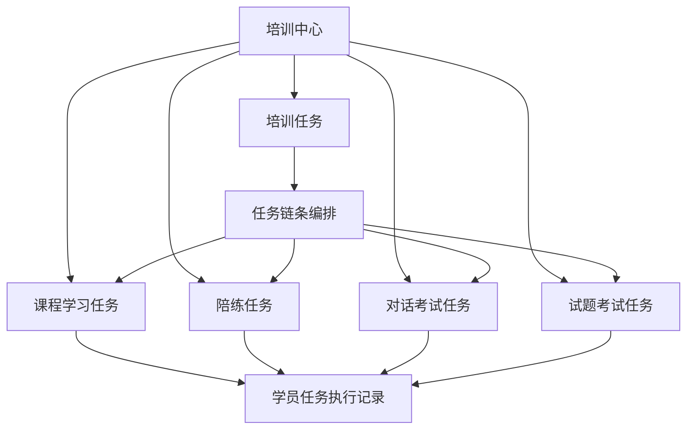
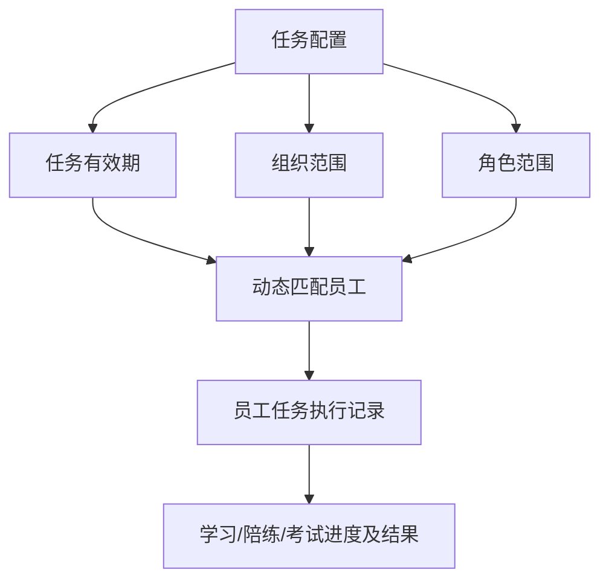

# AI陪练\_admin\_培训中心需求说明

**版本：V1.3**\
**依据原型：** `admin-1119(6).html`\
**模块范围：**
培训任务、课程学习任务、陪练任务、对话考试任务、试题考试任务

***

## 一、需求概述

### 1.1 建设目标

培训中心用于客户管理后台统一创建、配置、下发和管理学员需要完成的培训及考核任务。系统提供五类任务：

1. **培训任务**：将课程学习、陪练练习、对话考试、试题考试按顺序编排为一条培训任务链。
2. **课程学习任务**：指定课程及学员范围，要求学员完成课程学习。
3. **陪练任务**：指定剧本及学员范围，要求学员完成 AI 陪练。
4. **对话考试任务**：指定一个或多个剧本，并为每个剧本配置及格分，学员完成
   AI 对话考核。
5. **试题考试任务**：从题库选择题目并配置试卷分数、通过分数，学员在线答题考试。

五类任务均有独立的任务配置和任务记录。培训任务负责组织任务链条，不替代链中任务自身的设置与管理。

### 1.2 适用范围

本文描述 Admin
管理后台培训中心相关页面、页面交互、字段规则、任务下发范围及动态人员匹配逻辑。不涉及具体代码实现。

### 1.3 术语说明

***

术语                                说明

***

任务                                管理后台创建并下发给学员完成的业务单元

培训任务                            由若干类子任务组成、按步骤执行的任务链

链中任务                            被编排进培训任务的课程学习、陪练、对话考试或试题考试任务

学员范围                            任务覆盖的组织范围及可选角色范围

动态任务范围                        在任务有效期内，持续依据员工当前组织和角色判断其是否符合任务条件

## 任务执行记录                        某员工针对某项任务的领取、开始、进度、完成及结果记录

***

## 二、业务对象及关系

### 2.1 五类任务的关系

- 培训任务可以包含课程学习、陪练、对话考试、试题考试中的一种或多种。
- 培训任务中的任务类型是否包含、先后顺序由创建者配置。
- 每个启用的任务步骤必须至少配置一个对应的链中任务。
- 在培训任务创建页内，链中任务通过弹窗完成资源选择及必要配置；点击确定后关闭弹窗，并将配置结果加入当前任务链条，不再跳转至独立的新建任务页面。
- 从培训中心各任务列表直接新建课程学习、陪练、对话考试或试题考试任务时，仍按对应任务的独立新建页面流程进行。
- 链中任务与培训任务链条建立关联；培训任务详情展示链中任务及其执行情况，具体详情入口按任务详情页原型实现。

### 2.2 任务与学员的关系

每类任务均保存自己的任务设置、组织范围、角色范围和任务有效期，并据此确定学员覆盖范围。

- 一个任务可以覆盖多个组织。
- 一个任务可以指定多个角色。
- 角色不选择时，表示所选组织范围内的全部角色员工均符合条件。
- 勾选上级组织时，原型交互为自动连选其全部下级组织。
- 同一员工符合多个组织或角色条件时，同一任务只应形成一份有效执行记录，不应重复下发。

***

## 三、培训中心任务列表

### 3.1 页面组成

培训中心包含五个任务管理入口：

页面           页面用途

***

培训任务       管理培训任务链及其整体执行情况
课程学习任务   管理课程学习任务
陪练任务       管理 AI 陪练任务
对话考试       管理 AI 对话考试任务
试题考试       管理在线试题考试任务

### 3.2 列表通用交互

五类任务列表均支持按任务分组查看、关键字筛选、状态筛选、进入任务详情及新建任务。原型中的任务分组支持树形层级展示、展开/收起、新建分组、删除分组及任务转移分组；删除分组前需检查该分组及其子分组下是否仍有任务，有任务时不允许直接删除。

列表支持勾选任务及批量操作。具体操作项以原型对应列表的实际按钮为准。

### 3.3 各列表字段

***

列表                                字段

***

培训任务                            任务名称、任务链条、参与学员、任务时间、完成率、状态、更新时间

课程学习任务                        任务名称、参与学员、课程数、任务时间、完成率、状态、更新时间

陪练任务                            任务名称、参与学员、剧本数、任务时间、完成率、状态、更新时间

对话考试                            任务名称、参与学员、剧本数、及格分、任务时间、完成率、状态、更新时间

## 试题考试                            任务名称、考试类型、参与学员、题目数、总分、通过分数、任务时间、完成率、状态、更新时间

### 3.4 列表筛选

- 培训任务、课程学习任务、陪练任务、对话考试、试题考试均支持按状态筛选。
- 培训任务列表支持任务名称关键字及状态筛选。
- 各任务列表支持按左侧分组树过滤当前列表数据。
- 列表显示的参与学员数、完成率及状态应与任务执行记录统计保持一致。

***

## 四、课程学习任务

### 4.1 页面说明

课程学习任务用于将已发布课程下发给指定组织及角色的员工，学员在 APP/H5
学员端完成课程学习。

### 4.2 新建页面结构

页面分为三个区域：

1. 基础信息
2. 选择课程
3. 任务设置

页面右侧展示实时任务配置总览，随着表单填写实时更新。

### 4.3 字段说明

***

字段             类型                              必填 规则/含义

***

任务名称         单行文本                            是 最长100字，用于识别任务

任务说明         多行文本                            否 最长200字，展示在学员端任务详情

选择课程         多选列表                            是 从已创建且已发布的课程中选择，最多5门

课程分组         下拉选择                            否 用于筛选课程列表，不代表任务所属分组

课程名称搜索     文本搜索                            否 按课程名称搜索可选课程

所属分组         下拉选择                            是 选择课程学习任务自身所属分组

任务类型         单选                                否 手动推送/自动推送；自动推送在任务开始时间向符合范围的学员下发

任务开始时间     日期时间                            是 任务有效期开始时间

任务结束时间     日期时间                            是 任务有效期结束时间，必须晚于开始时间

学员范围-组织    组织树多选                          是 至少选择一个组织；勾选上级组织自动连选其全部下级

## 学员范围-角色    角色多选                            否 在所选组织范围内按角色筛选；不选表示全部角色

### 4.4 交互及校验

- 进入新建页面，填写基础信息。
- 从课程列表选择课程，可按课程分组筛选、按名称搜索；最多选择5门。
- 已选课程以已选状态/标签展示，可取消选择。
- 配置任务所属分组、推送方式、任务起止时间、组织范围和角色范围。
- 右侧实时总览展示任务名称、课程、分组、时间、学员范围。
- 点击提交时校验任务名称、至少选择一门课程、任务起止时间有效、至少选择一个组织。
- 点击取消返回课程学习任务列表，不保存本次新建内容。

### 4.5 完成规则

配置的课程全部学习至100%后，课程学习任务记为完成；未完成前学员可反复学习。

***

## 五、陪练任务

### 5.1 页面说明

陪练任务用于指定一个或多个已创建剧本，向指定组织及角色的员工下发 AI
陪练任务。学员在学员端进入任务，完成剧本陪练并生成陪练报告。

### 5.2 新建页面结构

页面分为三个区域：

1. 基础信息
2. 选择剧本
3. 任务设置

页面右侧展示实时任务配置总览。

### 5.3 字段说明

***

字段             类型                              必填 规则/含义

***

任务名称         单行文本                            是 最长100字

任务说明         多行文本                            否 最长200字，展示在学员端任务详情

选择剧本         多选列表                            是 从已创建的剧本中选择，最多5个

剧本分组         下拉选择                            否 用于筛选剧本列表

剧本名称搜索     文本搜索                            否 按剧本名称搜索

所属分组         下拉选择                            是 选择陪练任务自身所属分组

任务类型         单选                                否 手动推送/自动推送；自动推送在任务开始时间向符合范围的学员下发

任务开始时间     日期时间                            是 任务有效期开始时间

任务结束时间     日期时间                            是 任务有效期结束时间，必须晚于开始时间

学员范围-组织    组织树多选                          是 至少选择一个组织；勾选上级组织自动连选全部下级

## 学员范围-角色    角色多选                            否 在所选组织范围内按角色过滤；不选则全部角色生效

### 5.4 交互及校验

- 任务名称必填，最多100字；任务说明最多200字。
- 从已创建剧本中选择，最多5个；支持按剧本分组筛选和名称搜索。
- 配置所属分组、任务类型、任务起止时间、学员组织及角色范围。
- 右侧实时总览展示已选剧本、所属分组、任务时间和学员范围。
- 提交时校验任务名称、至少选择1个剧本、任务起止时间有效、至少选择1个组织。
- 点击提交后创建任务并进入陪练任务列表；若由培训任务链条入口创建，则保存后返回培训任务创建页并将该任务加入对应链条步骤。

### 5.5 完成规则

每个剧本完成陪练并生成陪练报告，即记为该剧本完成；任务中的剧本均完成后，陪练任务记为完成。未完成前学员可反复练习。

***

## 六、对话考试任务

### 6.1 页面说明

对话考试任务用于指定一个或多个剧本，对学员进行 AI
对话考核。每个剧本独立设置及格分，学员在对应剧本的考核得分达到该剧本及格分后，记为该剧本合格。

### 6.2 新建页面结构

页面分为三个区域：

1. 基础信息
2. 选择剧本及设置剧本及格分
3. 任务设置

页面右侧展示实时任务配置总览。

### 6.3 字段说明

***

字段                     类型                              必填 规则/含义

***

任务名称                 单行文本                            是 最长100字

任务说明                 多行文本                            否 最长200字，展示在学员端任务详情

选择剧本                 多选列表                            是 从已创建剧本中选择，最多5个

剧本分组                 下拉选择                            否 用于筛选剧本列表

剧本名称搜索             文本搜索                            否 按剧本名称搜索

剧本及格分（打标分数）   数字                                是 每个已选剧本单独设置，范围0--100分

所属分组                 下拉选择                            是 选择对话考试任务自身所属分组

任务类型                 单选                                否 手动推送/自动推送；自动推送在任务开始时间向符合范围的学员下发

任务开始时间             日期时间                            是 任务有效期开始时间

任务结束时间             日期时间                            是 任务有效期结束时间，必须晚于开始时间

防作弊                   开关                                否 原型标记为预留配置，本期不生效

学员范围-组织            组织树多选                          是 至少选择一个组织；勾选上级组织自动连选全部下级

## 学员范围-角色            角色多选                            否 在所选组织范围内按角色过滤；不选则全部角色生效

### 6.4 交互及校验

- 选择剧本后，为每个已选剧本分别填写及格分。
- 最多选择5个剧本。
- 每个已选剧本均需设置及格分，分值范围0--100。
- 配置所属分组、任务类型、任务时间、防作弊预留开关、学员范围。
- 右侧实时总览展示剧本及各自及格分、分组、任务时间、学员范围。
- 提交时校验任务名称、剧本数量、每个剧本及格分、任务起止时间和组织范围。
- 若由培训任务链条入口创建，保存后返回培训任务创建页并加入对应步骤。

### 6.5 完成规则

每个剧本生成陪练报告，且得分达到该剧本设置的及格分，记为该剧本合格；未通过可重考。任务完成情况按所配置剧本的考核结果汇总。

***

## 七、试题考试任务

### 7.1 页面说明

试题考试任务用于从题库中选择题目组成试卷，配置每道题的分数、试卷通过分数及考试时间，并下发给指定学员。

### 7.2 新建页面结构

页面分为三个区域：

1. 基础信息
2. 组卷配置
3. 任务设置

页面右侧展示实时任务配置总览。

### 7.3 字段说明

***

字段                 类型                              必填 规则/含义

***

任务名称             单行文本                            是 最长100字

任务说明             多行文本                            否 最长200字，展示在学员端任务详情

出题范围/题库分组    下拉/筛选                           否 用于限定题目选择范围；未指定时可从全部分组选择

题目选择             多选                                是 至少选择1道题目

每题分数             数字                                是 每道已选题目均需设置大于0的分数

试卷总分             汇总数值                            是 所有已选题目分数之和必须为100分

通过分数（及格分）   数字                                是 大于0且不大于100分

所属分组             下拉选择                            是 选择试题考试任务自身所属分组

任务类型             单选                                否 手动推送/自动推送；自动推送在任务开始时间向符合范围的学员下发

任务开始时间         日期时间                            是 任务有效期开始时间

任务结束时间         日期时间                            是 任务有效期结束时间，必须晚于开始时间

考试限时             数字                                否 单位分钟；0表示不限时

防作弊               开关                                否 原型标记为预留配置，本期不生效

学员范围-组织        组织树多选                          是 至少选择一个组织；勾选上级组织自动连选全部下级

## 学员范围-角色        角色多选                            否 在所选组织范围内按角色过滤；不选则全部角色生效

### 7.4 交互及校验

- 从题库选择题目，至少选择1道。
- 为每道已选题目配置分数。
- 系统实时汇总题目数量及试卷总分。
- 所有题目分数之和必须等于100分。
- 配置通过分数，分值必须大于0且不超过100分。
- 配置任务所属分组、任务类型、任务时间、考试限时、防作弊预留开关及学员范围。
- 右侧实时总览展示题目数量、出题范围、总分、通过分数、任务时间、考试限时和学员范围。
- 提交时校验任务名称、题目选择、每题分数、试卷总分、通过分数、任务时间及组织范围。
- 若由培训任务链条入口创建，保存后返回培训任务创建页并加入对应步骤。

### 7.5 完成规则

学员完成考试并生成成绩，得分达到通过分数记为通过；未完成前可反复参加考试。

***

## 八、培训任务（任务链条）

### 8.1 页面说明

培训任务用于将多种学习、练习和考试任务编排成有先后顺序的任务链，学员按链条顺序完成各阶段任务。

### 8.2 新建页面结构

页面分为三个区域：

1. 基础信息
2. 任务链条
3. 任务设置

页面右侧展示实时任务配置总览。

### 8.3 字段说明

***

字段             类型                              必填 规则/含义

***

任务名称         单行文本                            是 最长100字

任务说明         多行文本                            否 最长200字，展示在学员端任务详情

任务类型         单选                                否 手动推送/自动推送；自动推送在任务开始时间向符合范围的学员下发

任务链条步骤     可配置步骤列表                      是 课程学习、陪练练习、对话考试、试题考试；至少包含一种任务类型

是否包含该步骤   开关                                是 控制该类任务是否纳入任务链条

步骤顺序         拖动/上移下移                       是 决定学员执行先后顺序

链中任务         弹窗配置                            是 每个启用步骤至少配置一个链中任务；点击“新建”打开对应弹窗，完成资源选择/配置后点击确定加入当前步骤；不可从已创建任务中直接选择

所属分组         下拉选择                            是 选择培训任务自身所属分组

任务开始时间     日期时间                            是 培训任务有效期开始时间

任务结束时间     日期时间                            是 培训任务有效期结束时间，必须晚于开始时间

学员范围-组织    组织树多选                          是 至少选择一个组织；勾选上级组织自动连选全部下级

## 学员范围-角色    角色多选                            否 在所选组织范围内按角色过滤；不选则全部角色生效

### 8.4 任务链条配置交互

- 默认展示课程学习、陪练练习、对话考试、试题考试四类步骤。
- 每类步骤可设置是否包含。
- 可调整步骤顺序，步骤数组顺序即学员执行顺序。
- 启用某一步骤后，点击该步骤的“新建”按钮，在当前页面打开对应配置弹窗；不再跳转至独立任务新建页面。
- 弹窗标题按步骤类型动态显示：
  - 课程学习步骤：新建课程学习任务
  - 陪练步骤：新建陪练任务
  - 对话考试步骤：新建对话考试任务
  - 试题考试步骤：新建试题考试任务
- 弹窗统一提供“取消”和“确定”操作；点击右上角关闭按钮或“取消”，关闭弹窗且不将本次未确认的配置加入任务链条。
- 点击“确定”时先执行当前弹窗的必填项及业务规则校验；校验通过后关闭弹窗，将配置结果加入对应步骤，并刷新任务链条展示及右侧实时配置总览；校验不通过时留在弹窗内展示错误提示。
- 再次打开已配置的步骤弹窗时，应回显该步骤当前已选择的课程、剧本、及格分或组卷内容，支持继续调整。
- 链中任务不能从已创建的任务列表中直接选择；必须在当前培训任务的弹窗中配置。
- 课程学习弹窗：支持按课程分组筛选、按课程名称搜索、多选课程；最多选择5门，展示已选数量及已选课程标签；至少选择1门课程后方可确定。
- 陪练弹窗：支持按剧本分组筛选、按剧本名称搜索、多选剧本；最多选择5个，展示已选数量及已选剧本标签；至少选择1个剧本后方可确定。
- 对话考试弹窗：支持按剧本分组筛选、按剧本名称搜索、多选剧本；最多选择5个；每个已选剧本均需单独设置0—100分的及格分；至少选择1个剧本且全部剧本均设置及格分后方可确定。
- 试题考试弹窗：展示组卷配置区域，支持选择题库/题目并为每道已选题目设置分数；至少选择1道题目，每道题目分数必须大于0，所有题目分数之和必须为100分。
- 试题考试弹窗新增“通过分数（及格分）”设置项，字段类型为数字输入，必填；输入框支持0.5分步进，提示文案为“试卷总分为100分，学员得分达到及格分记为通过”。
- 通过分数的取值必须大于0分，且不得超过试卷总分100分；未填写、填写0分或超过100分均不允许确认弹窗，并在弹窗内展示对应错误提示。
- 弹窗右侧/任务配置总览应同步展示已配置的通过分数；再次打开已配置的试题考试弹窗时，应回显原有通过分数，允许修改。
- 点击“确定”时，必须同时校验题目数量、每题分数、试卷总分及通过分数；全部校验通过后，才可将试题考试配置加入培训任务链条。
- 培训任务自身的分组、任务类型、任务时间、学员范围仍在培训任务主页面配置；链中弹窗仅负责当前步骤对应资源及原型中展示的专项配置，不在弹窗内重复配置培训任务主页面字段。
- 提交培训任务前，至少启用一种任务类型，且每个启用步骤至少完成一次有效弹窗配置。

### 8.5 执行规则

- 学员按配置的任务链条顺序执行。
- 完成当前阶段的全部链中任务后，自动解锁下一阶段。
- 学员完成全部阶段后，培训任务记为完成。
- 链中任务的完成状态和结果由各自任务记录提供，培训任务汇总展示整体执行情况。

***

## 九、动态任务范围与新增员工自动下发规则

> 本章节为本次补充的重点需求，适用于五类任务：培训任务、课程学习任务、陪练任务、对话考试任务、试题考试任务。

### 9.1 核心规则

任务的组织及角色范围采用动态匹配机制，不仅在任务创建或首次推送时匹配一次人员。

**在任务有效期内，凡是新建账号或后续组织/角色发生变化后，满足该任务组织范围及角色范围的员工，系统均应自动将任务推送给该员工。**

该规则适用于手动推送和自动推送任务：

- 自动推送：任务到达开始时间后，向当前符合条件的员工下发；有效期内后续新增的符合条件员工也自动获得任务。
- 手动推送：管理员执行手动推送后，向当前符合条件的员工下发；任务有效期内后续新增的符合条件员工也自动纳入并获得任务。未执行首次手动推送前，不应仅因新员工创建而提前推送任务。

### 9.2 人员匹配条件

员工需同时满足以下条件：

1. 员工账号属于当前租户，且账号在当前租户下未停用。
2. 员工当前归属组织位于任务所选组织范围内。
3. 任务指定了角色时，员工当前拥有至少一个被指定角色；未指定角色时，所选组织范围内所有角色均符合。
4. 当前时间处于任务有效期内。
5. 任务处于允许下发/执行的状态，且未超过任务结束时间。

**匹配逻辑：**

`任务覆盖员工 = 当前租户有效员工 ∩ 任务组织范围 ∩ 任务角色范围 ∩ 任务有效期`

其中，角色范围为空表示不按角色过滤。

### 9.3 触发场景

***

触发场景                                 是否重新匹配 处理规则

***

新建员工账号                                       是 员工组织、角色符合条件且任务有效时，自动生成任务执行记录并推送

员工加入任务覆盖组织                               是 加入组织后符合条件，自动获得任务

员工从组织A调入组织B                               是 重新判断B是否在任务范围内；符合则获得任务

员工新增任务指定角色                               是 角色变更后符合条件，自动获得任务

员工移除任务指定角色                               是 不再符合后续任务资格；已产生的历史执行记录保留

员工调出任务组织范围                               是 不再获得新的任务；已产生的历史记录保留

员工在任务有效期外新增                             是 不下发该任务

任务有效期开始                                     是 按当前组织、角色范围匹配员工并执行任务下发策略

任务首次手动推送                                   是 向当时符合条件的员工推送，并开启后续动态纳入

## 任务结束/停用                                      是 停止新增任务执行记录及后续推送

### 9.4 新增账号自动获得任务的示例

任务配置如下：

- 任务名称：新车型销售话术陪练
- 下发组织：上海区域及其下属门店
- 下发角色：销售顾问
- 任务有效期：11月25日至12月31日

人员变化及结果：

***

人员变化                              是否获得任务            原因

***

任务创建时已存在的上海销售顾问        是                      符合组织及角色范围

11月28日新建的上海销售顾问账号        是                      任务仍在有效期内，符合范围

12月2日新建的上海服务顾问账号         否                      角色不符合

12月5日从其他区域调入上海的销售顾问   是                      调入后符合范围

12月8日从销售顾问变更为服务顾问       不再获得新的任务        角色变更后不符合范围

## 2027年1月新建的上海销售顾问账号       否                      已超过任务有效期

### 9.5 任务执行记录处理

- 同一员工对同一任务只能存在一份有效任务执行记录，避免重复下发。
- 新匹配员工首次获得任务时，生成独立的学员任务执行记录。
- 员工已经获得任务后，重复触发人员匹配不得重复创建任务记录。
- 员工已经开始或完成任务后，组织或角色发生变化，不得删除其已产生的执行记录及学习、陪练、考试结果。
- 员工调出任务范围后，保留历史执行记录；不再为其生成新的任务执行记录。
- 员工重新进入任务范围且任务仍有效时，重新判断是否需要恢复任务资格；不得覆盖已有完成记录。
- 员工账号在某租户停用时，不再向该员工推送该租户内的新任务；其他租户不受影响。

### 9.6 培训任务与链中任务的动态范围

培训任务与链中任务的学员范围分别配置、分别生效：

- 培训任务自身组织/角色范围，决定员工是否获得培训任务主任务。
- 链中课程学习、陪练、对话考试、试题考试任务各自的组织/角色范围，决定员工是否获得对应子任务。
- 培训任务链条内的子任务配置不因培训任务的学员范围自动覆盖或改写。
- 对于培训任务链条执行，需确保主任务与链中任务的覆盖人员关系一致或可解释；若员工只符合培训任务主任务范围但不符合某个链中任务范围，应按链中任务自身范围处理，并在执行统计中明确未覆盖情况，不能静默生成不符合范围的子任务。

### 9.7 推送幂等及统计口径

- 系统需以租户、任务、员工为维度识别任务执行记录，避免多次触发生成重复记录。
- 新员工自动纳入后，任务覆盖人数应相应更新。
- 完成率的分母应按当前有效任务覆盖人员口径统计；已离开组织/角色范围的人员是否从实时分母剔除，需要保留历史口径以便追溯。
- 任务列表、任务详情、执行跟踪及学员端任务列表应使用一致的任务覆盖与执行记录口径。

***

## 十、任务详情

### 10.1 通用详情结构

五类任务详情均按照对应新建页面的信息展示，包含：

- 基础信息
- 选择资源（课程、剧本或组卷）
- 任务设置
- 学员范围

任务详情应展示任务名称、任务说明、所属分组、任务类型、任务时间、学员范围、角色范围及当前执行情况。

### 10.2 培训任务详情

培训任务详情包含：

1. 基础信息：任务名称、任务类型、状态、完成率、更新时间、任务说明。
2. 任务链条：按配置顺序展示步骤、步骤说明及链中任务；点击链中任务进入其独立详情页。
3. 任务设置：所属分组、任务时间。
4. 学员范围：覆盖学员数、组织范围、角色范围及动态纳入说明。

### 10.3 任务设置编辑

原型提供培训任务详情中的"配置任务设置"入口。编辑保存后应更新对应任务设置，并保持已产生的学员执行记录及历史结果。对任务有效期、组织范围、角色范围等关键字段的修改，应重新执行动态人员匹配。

***

## 十一、任务推送及执行流程

### 11.1 手动推送

1. 管理员创建任务并配置资源、任务时间及学员范围。
2. 管理员在任务列表执行手动推送。
3. 系统根据当前有效期、组织及角色范围匹配员工。
4. 为符合条件且尚无执行记录的员工生成任务执行记录。
5. 在任务有效期内，新建或变更为符合条件的员工自动纳入。
6. 任务到期或停用后停止新增推送。

### 11.2 自动推送

1. 管理员创建任务并选择自动推送。
2. 系统保存任务及推送规则。
3. 到达任务开始时间，系统匹配当前符合条件的员工并推送。
4. 在任务有效期内，持续监听员工新增、组织变更、角色变更等事件。
5. 新符合条件的员工自动获得任务。
6. 任务到期或停用后停止新增推送。

### 11.3 培训任务执行

1. 学员获得培训任务主任务。
2. 按任务链条配置顺序进入第一阶段。
3. 当前阶段内所有链中任务完成后，解锁下一阶段。
4. 所有阶段完成后，培训任务主任务完成。
5. 各链中任务独立保存执行结果，培训任务汇总展示整体完成情况。

***

## 十二、状态及结果说明

原型列表中展示任务状态，包括未开始、进行中、已结束、已停用等状态。具体状态判定应结合任务有效期、任务是否停用及学员执行情况。

状态     说明

***

未开始   尚未到任务开始时间，或任务尚未进入执行阶段
进行中   当前处于任务有效期且任务可执行
已结束   已超过任务结束时间
已停用   管理员停用任务，不再继续下发或执行

学员执行状态、任务整体状态及考试通过结果属于不同维度，不应混用。任务是否完成，应按各任务类型的完成规则判定。

***

## 十三、异常及边界场景

***

场景                                         处理要求

***

任务未选择组织                               不允许提交

任务未选择课程/剧本/题目                     不允许提交

任务开始时间晚于或等于结束时间               不允许提交

试题考试题目分数合计不等于100                不允许提交

对话考试部分剧本未配置及格分                 不允许提交

新员工重复触发自动匹配                       不重复创建任务执行记录

员工调出任务组织范围                         保留历史记录，不再纳入新的任务

员工角色变更                                 按最新角色重新匹配

任务已过期                                   不向新员工推送

任务已停用                                   停止新增推送

员工租户账号停用                             不向该租户账号推送任务

链中任务创建后取消培训任务                   链中任务是否保留为独立任务需按管理操作规则处理，不应静默删除

## 员工符合培训主任务范围但不符合链中任务范围   依据链中任务自身范围处理，并在执行统计中体现覆盖差异

***

## 十四、权限要求

- 用户需具备对应任务模块的查看、新建、编辑、删除、推送等操作权限，方可执行相应操作。
- 管理后台数据权限按账号角色配置的数据范围执行。
- 任务可见范围及可操作范围应受当前租户、组织数据权限约束。
- 任务学员范围只能从当前租户组织架构及角色管理中选择。
- 学员端仅展示当前账号在当前租户下有权访问且符合任务下发范围的任务。

***

## 十五、与其他模块的关系

***

关联模块                            关联方式

***

组织架构管理                        提供任务下发时选择的组织树；组织新增、员工调动等变化触发动态匹配

员工管理                            提供员工账号、所属组织、租户状态等信息；新增账号及组织变更触发任务匹配

角色管理                            提供任务可选择的角色；员工角色变更触发任务匹配

课程管理                            课程学习任务只能选择已发布课程

剧本管理                            陪练、对话考试任务从剧本管理中选择剧本

题库管理                            试题考试任务从题库选择题目

APP/H5学员端                        接收任务、展示任务详情、执行课程学习/陪练/考试并提交结果

## 任务执行跟踪                        汇总任务覆盖人数、领取/开始/完成情况及考试结果

***

## 十六、待确认事项

以下事项原型未给出完整规则，需产品与研发进一步确认，不应直接视为已确定需求：

1. 手动推送任务在首次推送后，动态新增员工自动获得任务的具体推送时机（实时事件触发或定时扫描）。
2. 员工调出组织或角色范围后，已领取但未开始的任务是否从学员端隐藏，还是保留但禁止继续执行。

   回复：员工调出组织或角色范围后，未开始任务直接隐藏
3. 员工离开范围后又重新进入范围，且已有未完成记录时，是恢复原记录还是重新开放任务。

   回复：恢复原记录
4. 培训任务主任务与链中任务覆盖范围不一致时，是否要求创建时强制校验一致。

   回复：培训任务与另外4个任务相互独立，不互相影响
5. 培训任务的完成率分母，按主任务覆盖员工数还是按全部链中任务实际覆盖员工数计算。

   回复：按覆盖员工数
6. 任务有效期内修改组织范围、角色范围或任务结束时间时，是否需要二次确认并展示影响人数。

   回复：触发二次确认
7. 任务结束后，学员端是否继续展示历史任务及完成报告。

   回复：展示，页面还没有出
8. 任务被停用后，已开始任务是否允许学员继续完成。

   回复：可以继续完成

***

## 附录：本次版本变更

**V1.1 相较于原型整理版的补充：**

- 新增"动态任务范围与新增员工自动下发规则"章节。
- 明确五类任务均适用组织/角色动态匹配。
- 明确任务有效期内新增账号、组织调动、角色变更后，符合条件的员工自动获得任务。
- 明确手动推送与自动推送在首次推送时机上的差异。
- 明确同一员工同一任务执行记录需幂等，避免重复下发。
- 明确员工调出范围后历史执行记录保留。
- 明确培训任务主任务与链中任务各自独立配置学员范围，不相互覆盖。

***

## 十五、V1.2 本次原型调整说明

本版本依据 `admin-1119(5).html` 更新培训任务链条中新建链中任务的交互方式：

1. 原“点击新建后跳转至对应任务独立新建页面”调整为“点击新建后在当前培训任务页面弹出配置窗口”。
2. 新建课程学习任务、陪练任务、对话考试任务、试题考试任务均采用弹窗方式。
3. 弹窗内按任务类型提供课程选择、剧本选择、剧本及格分设置或试题组卷配置。
4. 点击确定后完成校验并将配置加入当前培训任务链条；取消或关闭弹窗不提交本次配置。
5. 再次打开已配置步骤时，回显当前已选内容，支持继续调整。
6. 从培训中心对应任务列表直接新建独立任务的流程不因本次调整而改变，仍使用原独立任务新建页面。

**说明：** 本次调整仅涉及“培训任务创建过程中的链中任务配置入口与交互方式”，不改变培训任务链条的步骤类型、步骤排序、阶段解锁及任务完成规则。

***

## 十六、V1.3 本次原型调整说明

本版本依据 `admin-1119(6).html` 更新培训任务链条中的“新建试题考试任务”弹窗：

1. 在试题考试弹窗的组卷配置区域增加“通过分数（及格分）”必填数字输入项。
2. 试卷总分固定为100分，学员考试得分达到该通过分数时，判定本次试题考试通过。
3. 通过分数必须大于0分且不超过100分；输入框按0.5分步进。
4. 点击弹窗“确定”前，除校验题目选择、每题分数及试卷总分外，还必须校验通过分数；未填写、为0或超过100分时不允许确认，并显示错误提示。
5. 通过分数需纳入当前试题考试弹窗配置数据及培训任务配置总览；再次打开弹窗时回显已配置的通过分数，支持修改。
6. 本次仅补充培训任务链条内试题考试弹窗的通过分数配置，不改变独立试题考试任务已有的通过分数设置及其考试完成判定规则。
