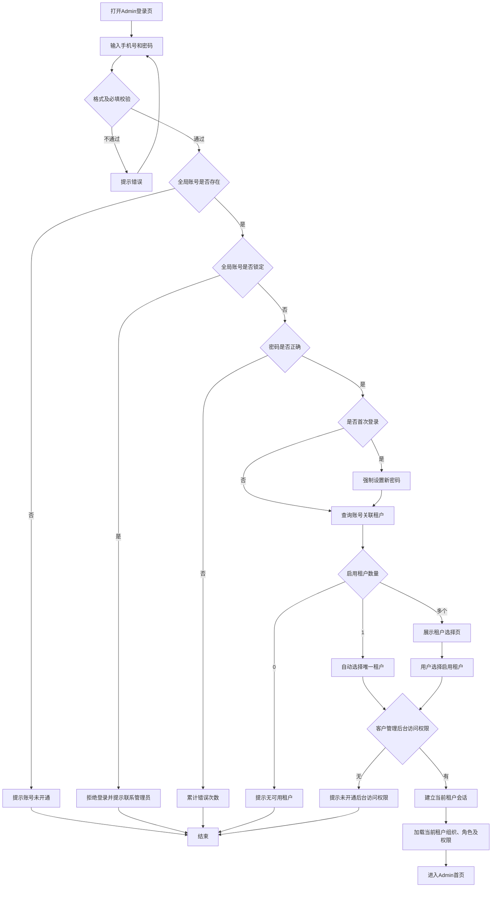

# AI陪练_admin_登录模块需求说明

**文档版本：V1.2**  
**适用端：** AI陪练客户管理后台（PC Admin）  
**需求依据：**
1. `admin-1111(2).html`：客户管理后台最新原型，登录页、租户选择、首次登录设置密码、忘记密码、后台修改密码、退出登录，以及员工详情页管理员重置员工登录密码。
2. 《AI陪练 SaaS底层基础架构与权限设计说明 V1.2》。
3. 《AI陪练_组织架构员工角色管理需求说明_V1.1》。

> 本文仅描述Admin管理后台的登录、租户选择、密码管理和退出登录。不包含学员端APP登录、APP首次改密及APP忘记密码页面。原型中的演示账号、演示密码及任意验证码等体验内容不作为正式需求。

---

# 一、需求范围与基础规则

## 1.1 页面清单

| 页面/弹层 | 页面类型 | 说明 |
|---|---|---|
| Admin登录页 | 登录页 | 手机号、密码登录 |
| 租户选择页 | 选择页 | 一个账号关联多个可用租户时选择进入 |
| 首次登录设置密码页 | 表单页 | 初始密码登录后强制修改全局账号密码 |
| 忘记密码弹窗 | 弹窗 | 手机号短信验证后重置全局账号密码 |
| 后台修改密码页 | 后台内页/表单页 | 已登录用户主动修改全局账号密码 |
| 退出登录 | 顶部用户菜单操作 | 退出当前后台会话并清理租户上下文 |

## 1.2 全局账号与租户规则

1. 系统使用全局账号，一个全局账号对应一个用户身份，以手机号和密码登录。
2. 一个全局账号可以关联多个租户；每个租户分别维护该账号的成员状态、组织归属、角色和应用访问权限。
3. 同一全局账号在同一租户内原则上只保留一条成员关系。
4. 全局账号状态与租户成员状态独立：
   - 全局账号锁定：该账号在所有租户均无法登录。
   - 某租户成员停用：该账号不能进入该租户，但不影响其他已启用租户。
5. Admin登录成功后还需校验当前租户有效性、成员状态及“客户管理后台访问”权限。
6. 登录或切换租户后，只加载当前租户的组织、角色、权限和业务数据。
7. 首次登录修改密码、后台修改密码及忘记密码重置的均为全局账号密码；修改后该账号在所有租户均使用新密码。
8. 本后台不提供自助注册入口，账号由租户管理员或平台开通流程创建。

## 1.3 Admin登录总流程

流程约束：
- 首次登录修改密码在租户查询/选择之前。
- 停用租户可展示状态，但不可点击进入。
- 只有一个启用租户时自动选择，不展示租户选择页。
- 选择租户后服务端再次校验租户状态及成员状态。
- 当前租户没有“客户管理后台访问”权限时不得进入Admin。
- 进入后台后会话绑定全局账号、当前租户及当前租户成员身份。

---

# 二、Admin登录页

**页面类型：** PC登录页。  
**原型布局：** 左侧品牌介绍区、右侧登录表单；窄屏时登录表单居中展示。

## 2.1 字段说明

| 字段 | 类型 | 必填 | 校验 | 含义 |
|---|---|---:|---|---|
| 手机号 | tel文本输入 | 是 | 11位手机号格式；去除首尾空格 | 全局账号登录标识 |
| 密码 | password输入 | 是 | 不允许为空，由服务端验证 | 全局账号登录密码 |
| 显示/隐藏密码 | 图标按钮 | 否 | 点击切换明文/密文 | 仅改变展示形式 |
| 记住此账号 | 复选框 | 否 | 默认不勾选 | 勾选后记住手机号，不保存密码 |
| 登录 | 主按钮 | - | 通过前端必填及格式校验 | 提交全局账号认证 |
| 忘记密码 | 文本链接 | - | - | 打开重置密码弹窗 |

## 2.2 页面交互

1. 用户输入手机号和密码，点击“登录”提交；在密码框按Enter等同点击登录。
2. 手机号格式错误、密码为空时，前端提示并阻止提交。
3. 密码默认密文显示，点击眼睛图标切换显示状态。
4. 勾选“记住此账号”后保存手机号，下次打开登录页回填；不得保存密码、验证码或令牌。
5. 点击“忘记密码？”打开重置密码弹窗。
6. 登录失败在表单上方展示错误信息；手机号可保留，密码按安全策略清空。
7. 登录过程中按钮展示加载状态，防止重复提交。
8. 页面不提供注册入口，账号由企业管理员开通。

## 2.3 认证异常处理

| 情况 | 系统处理 |
|---|---|
| 手机号格式不正确 | 提示请输入正确的11位手机号 |
| 密码为空 | 提示请输入登录密码 |
| 手机号未开通 | 提示账号尚未开通，请联系企业管理员 |
| 全局账号锁定 | 拒绝登录，提示该账号所有租户均无法登录 |
| 密码错误 | 提示密码错误及剩余尝试次数 |
| 连续错误达到阈值 | 按服务端安全策略临时锁定全局账号 |
| 登录认证成功 | 进入首次改密判断及租户选择流程 |

---

# 三、首次登录设置密码页

**页面类型：** 表单页。  
**触发条件：** 全局账号使用初始密码登录，认证服务返回首次改密标记。

## 3.1 字段说明

| 字段 | 类型 | 必填 | 校验 | 含义 |
|---|---|---:|---|---|
| 新密码 | password输入 | 是 | 至少8位，且同时包含英文字母和数字 | 用户设置的正式登录密码 |
| 确认新密码 | password输入 | 是 | 必须与新密码完全一致 | 防止重复输入错误 |
| 确认并设置 | 按钮 | - | 字段校验通过后可提交 | 提交全局密码修改 |
| 返回登录 | 文本/按钮 | - | - | 终止本次登录流程并返回登录页 |

## 3.2 页面交互

1. 展示首次登录说明及密码规则。
2. 用户填写新密码和确认新密码，点击“确认并设置”。
3. 前端校验必填、长度、字母数字组合及两次输入一致性。
4. 服务端再次校验并更新全局账号密码。
5. 成功后清除首次登录标记，继续查询租户及后续登录流程。
6. 失败时停留当前页并显示原因；不允许跳过改密直接进入应用。
7. 返回登录入口用于终止本次登录流程。

---

# 四、租户选择页

**页面类型：** 选择页。  
**触发条件：** 全局认证成功且首次改密完成后，账号存在两个及以上启用租户成员关系。

## 4.1 字段说明

| 字段 | 类型 | 必填 | 校验 | 含义 |
|---|---|---:|---|---|
| 租户名称 | 文本展示 | 是 | 服务端返回 | 当前账号关联的租户名称 |
| 租户标识 | 图标/文本 | 否 | 服务端返回 | 区分不同租户 |
| 应用名称 | 文本展示 | 是 | 固定显示客户管理后台 | 当前登录入口 |
| 当前成员角色 | 文本/标签 | 否 | 服务端返回 | 当前账号在该租户内的角色摘要 |
| 成员状态 | 状态标签 | 是 | 启用/停用 | 当前租户成员状态 |
| 租户卡片 | 可点击卡片 | 是（启用租户） | 停用状态不可点击 | 选择本次登录租户 |

## 4.2 页面交互

1. 展示账号关联的租户列表。
2. 启用租户可点击；停用租户置灰并标记“成员已停用”。
3. 点击启用租户后，服务端再次校验租户有效状态和成员状态。
4. 校验通过后，检查该租户是否拥有“客户管理后台访问”权限。
5. 权限通过后建立当前租户会话，加载当前租户组织、角色、权限，进入后台首页。
6. 权限不通过时提示未开通管理后台访问权限，并允许返回选择其他租户。
7. 点击“返回登录”回到登录页。

## 4.3 租户数量规则

- 0个启用租户：提示没有可用租户成员身份，不进入系统。
- 1个启用租户：自动选择并校验后台访问权限，不展示租户选择页。
- 2个及以上启用租户：展示租户选择页。
- 停用租户可显示但不可进入。

---

# 五、忘记密码弹窗

**页面类型：** PC弹窗。  
**触发入口：** 登录页“忘记密码？”。

## 5.1 字段说明

| 字段 | 类型 | 必填 | 校验 | 含义 |
|---|---|---:|---|---|
| 手机号 | tel文本输入 | 是 | 11位手机号格式；需关联全局账号 | 接收短信验证码的手机号 |
| 短信验证码 | 数字输入 | 是 | 6位数字；须与服务端验证码一致且未过期 | 验证手机号控制权 |
| 获取验证码 | 按钮 | - | 手机号有效且满足发送频控 | 发送验证码，成功后倒计时 |
| 新密码 | password输入 | 是 | 至少8位，且同时包含字母和数字 | 重置后的全局密码 |
| 确认新密码 | password输入 | 是 | 与新密码一致 | 确认密码 |
| 取消/关闭 | 按钮 | - | - | 关闭弹窗，不提交重置 |
| 重置密码 | 按钮 | - | 全部字段校验通过 | 提交密码重置 |

## 5.2 页面交互

1. 打开弹窗，输入手机号并点击“获取验证码”。
2. 服务端校验手机号、账号状态及短信频控，发送验证码。
3. 发送成功后按钮倒计时，结束后可重新获取。
4. 输入验证码、新密码及确认密码，点击“重置密码”。
5. 服务端验证验证码有效性、密码规则及两次输入一致性。
6. 成功后更新全局账号密码，清除首次改密标记（如适用），关闭弹窗并提示使用新密码登录。
7. 失败时保留弹窗并展示错误原因；取消/关闭不改变密码。
8. 密码重置后，按统一认证安全策略处理该全局账号已有会话。

---

# 六、后台修改密码页

**页面类型：** 已登录后台内页/表单页。  
**触发入口：** 后台顶部用户头像菜单中的“修改密码”。

## 6.1 字段说明

| 字段 | 类型 | 必填 | 校验 | 含义 |
|---|---|---:|---|---|
| 原密码 | password输入 | 是 | 必须与当前全局账号密码匹配 | 验证当前操作者身份 |
| 新密码 | password输入 | 是 | 至少8位，且同时包含英文字母和数字 | 修改后的全局登录密码 |
| 确认新密码 | password输入 | 是 | 必须与新密码一致 | 防止重复输入错误 |
| 返回/取消 | 按钮 | - | - | 放弃本次修改，返回后台 |
| 确认修改 | 主按钮 | - | 全部校验通过 | 提交全局账号密码修改 |

## 6.2 页面交互

1. 用户登录后台后，点击顶部用户头像，选择“修改密码”。
2. 进入修改密码页面，展示原密码、新密码、确认新密码三个输入项。
3. 用户输入原密码、新密码和确认新密码。
4. 前端校验必填、新密码规则、新旧密码不能相同、两次新密码一致。
5. 服务端再次校验原密码，验证通过后更新全局账号密码。
6. 修改成功提示“密码修改成功，请使用新密码登录”。
7. 按统一认证安全策略处理当前会话及该全局账号在其他租户的已有会话；若策略要求重新认证，则返回登录页重新登录。
8. 修改失败时保留当前页面并提示具体原因，不更新密码。
9. 点击取消/返回不提交修改，返回之前的后台页面。

## 6.3 业务规则

1. 修改的是全局账号密码，不是当前租户独立密码。
2. 修改成功后，该账号在所有关联租户均使用新密码。
3. 修改密码不改变账号关联租户、租户成员状态、组织归属、角色及权限。
4. 密码不得明文存储或写入操作日志。
5. 密码修改接口必须由服务端执行身份验证和密码规则校验。

---

# 七、退出登录

**页面类型：** 顶部用户菜单操作；如产品设置确认弹窗，则使用确认弹窗。  
**触发入口：** 后台顶部用户头像菜单 → 退出登录。

## 7.1 页面交互

1. 用户点击头像，展开用户菜单。
2. 点击“退出登录”。
3. 如配置二次确认，弹出确认提示；用户确认后执行退出，取消则留在当前页面。
4. 系统向认证服务发起当前会话退出/撤销请求。
5. 认证服务确认退出后，前端清理当前登录状态及租户上下文。
6. 清理当前页面中的账号身份、租户信息、权限缓存及会话令牌。
7. 返回Admin登录页。
8. 再次访问后台受保护页面时，必须重新登录，不得通过浏览器返回恢复有效会话。

## 7.2 退出范围

1. 退出登录默认只退出当前浏览器/当前设备的当前会话。
2. 不删除全局账号。
3. 不改变当前租户成员状态。
4. 不影响该账号在其他租户的成员关系。
5. 不影响其他设备或其他浏览器会话；如后续提供“退出所有设备”，作为独立功能处理。
6. “记住此账号”仅用于回填手机号，不属于登录会话。用户主动勾选时可保留手机号；不得保留密码、验证码或令牌。

---

# 八、各种Admin登录情况及完整链路

## 8.1 单租户账号，非首次登录

条件：全局账号正常、密码正确，仅有一个启用租户成员关系、租户有效且后台访问权限已开通。

1. 输入手机号、密码。
2. 服务端验证全局账号存在且未锁定。
3. 验证密码正确。
4. 检查首次登录标记；非首次登录则继续。
5. 查询启用租户，只有一个时自动选择。
6. 校验该租户有效、成员启用及客户管理后台访问权限。
7. 建立当前租户会话，加载该租户组织、角色、权限。
8. 进入Admin首页，不展示租户选择页。

## 8.2 多租户账号，非首次登录

1. 完成全局账号认证。
2. 查询该账号关联的租户成员关系。
3. 展示租户选择页。
4. 用户选择一个启用租户。
5. 服务端再次校验成员状态、租户状态。
6. 校验客户管理后台访问权限。
7. 建立当前租户会话并加载该租户权限、数据。
8. 进入Admin首页。

## 8.3 多租户账号，部分租户成员停用

1. 用户完成全局账号认证。
2. 系统查询账号关联的全部租户。
3. 租户选择页展示全部租户。
4. 启用租户可选；停用租户置灰并标注“成员已停用”。
5. 用户只能选择启用租户。
6. 进入所选租户前再次校验成员状态及后台访问权限。
7. 停用租户不影响账号进入其他启用租户。

## 8.4 首次登录，需要修改密码

1. 输入手机号和初始密码。
2. 全局账号认证成功。
3. 服务端返回首次登录/初始密码标记。
4. 强制进入设置密码页。
5. 输入新密码和确认密码。
6. 校验至少8位、同时包含字母和数字、两次输入一致。
7. 服务端更新全局账号密码，清除首次登录标记。
8. 查询启用租户；单租户自动选择，多租户进入选择页。
9. 校验客户管理后台访问权限。
10. 建立当前租户会话并进入Admin首页。

## 8.5 全局账号被锁定

1. 用户提交手机号和密码。
2. 服务端发现全局账号状态为锁定。
3. 直接拒绝认证，不进入改密或租户选择流程。
4. 提示账号已锁定及联系管理员的处理方式。
5. 管理员按账号安全流程解除锁定后，用户才能重新登录。

全局锁定对该账号所有租户生效，不能通过切换租户绕过。

## 8.6 当前租户成员已停用

1. 用户完成全局账号认证。
2. 系统查询账号关联租户。
3. 停用租户成员标记为不可进入。
4. 用户不能进入该租户。
5. 如有其他启用租户，可选择其他租户。
6. 如所有租户成员均停用，提示没有可用租户。

当前租户成员停用不修改全局账号状态，不影响其他租户。

## 8.7 没有Admin访问权限

1. 用户完成全局账号认证。
2. 单租户自动选择，或多租户由用户选择。
3. 服务端校验当前租户成员的客户管理后台访问权限。
4. 无该权限时拒绝进入后台。
5. 提示联系当前租户管理员开通客户管理后台访问权限。
6. 多租户用户可返回租户选择页尝试其他租户。

## 8.8 密码错误及临时锁定

1. 用户输入手机号和错误密码。
2. 服务端按全局账号维度累计连续认证失败次数。
3. 未达到阈值时提示密码错误及剩余尝试次数。
4. 达到阈值后按安全策略临时锁定全局账号。
5. 锁定期间该账号所有租户均不能登录。
6. 锁定解除后可重新认证。

阈值、锁定时长、失败计数重置窗口及人工解锁规则由服务端统一配置。原型示例中的次数仅作界面演示，不作为正式安全参数。

## 8.9 忘记密码并重置成功

1. 用户在Admin登录页点击忘记密码。
2. 输入全局账号手机号并获取短信验证码。
3. 服务端发送验证码，并校验有效期、频控和错误次数。
4. 用户输入验证码、新密码、确认密码。
5. 服务端验证通过后更新全局账号密码。
6. 提示重置成功，用户返回登录页重新登录。
7. 新密码对该账号关联的所有租户生效；各租户成员状态、组织、角色和应用权限不变。

## 8.10 后台主动修改密码成功

1. 用户在Admin后台用户菜单点击修改密码。
2. 输入原密码、新密码和确认密码。
3. 前端及服务端校验原密码、新密码规则和两次输入一致性。
4. 服务端更新全局账号密码。
5. 提示修改成功。
6. 按认证服务会话策略处理当前及其他设备会话；如当前会话被撤销，则返回Admin登录页重新登录。
7. 所有关联租户统一使用新密码，租户成员资料及权限不变。

## 8.11 手机号未开通账号

1. 用户输入手机号和密码。
2. 服务端查询全局账号。
3. 未查询到账号则拒绝登录。
4. 提示账号尚未开通，请联系企业管理员。
5. 登录页不提供自助注册。

---

# 九、安全及研发要求

1. **统一认证：** Admin使用全局账号认证服务，不单独维护密码。
2. **租户上下文：** 登录会话绑定全局账号、当前租户和当前租户成员身份；每次业务请求校验租户边界。
3. **应用访问鉴权：** 服务端校验当前租户是否拥有客户管理后台访问权限，不能只依赖前端隐藏入口。
4. **成员状态实时校验：** 当前租户成员停用后立即阻断该租户访问；其他租户不受影响。
5. **全局锁定实时生效：** 全局账号锁定后阻断所有租户访问，并按安全策略处理已有会话。
6. **密码安全：** 传输使用加密通道；服务端使用安全单向哈希算法存储密码，不得明文保存。
7. **验证码安全：** 验证码由服务端生成、发送、校验，具备有效期、发送频控、错误次数限制及一次性使用机制。
8. **防暴力破解：** 认证失败次数按全局账号维度累计，阈值、锁定时长及计数窗口由服务端统一配置。
9. **会话安全：** 退出登录、密码重置、全局锁定、租户成员停用等事件按规则撤销或使相关会话失效。
10. **权限重新加载：** 登录或切换租户后重新加载当前租户组织、角色、应用访问权限、功能权限及数据权限。
11. **登录日志：** 记录账号、登录端、租户（认证完成后）、时间、IP/设备信息、结果及失败原因；日志不得记录密码、验证码或令牌。
12. **敏感信息保护：** 手机号按权限脱敏；密码、验证码、令牌不得写入日志或前端持久化存储。
13. **退出清理：** 退出时撤销当前会话并清理前端账号身份、租户上下文、权限缓存和认证凭证；记住账号只允许保留手机号。

---

# 十、待确认事项

| 编号 | 待确认事项 | 当前建议 |
|---|---|---|
| A01 | 首次登录改密顺序 | 按原型执行：认证后先改密，再查询/选择租户 |
| A02 | 首次登录标记归属 | 按全局账号维护，修改一次后所有租户生效 |
| A03 | 密码错误锁定规则 | 确认阈值、锁定时长、计数窗口、自动/人工解锁 |
| A04 | 锁定账号是否允许自助重置 | 建议默认不允许，按安全策略确认 |
| A05 | 短信验证码规则 | 确认有效期、发送频控、错误次数、短信服务商 |
| A06 | 无可用租户提示 | 展示无可用租户提示，可返回登录或联系管理员 |
| A07 | 无后台访问权限提示 | 明确提示联系当前租户管理员；多租户可返回租户选择 |
| A08 | 记住此账号 | 仅保存手机号，明确本地存储及清除规则 |
| A09 | 后台修改密码后的会话策略 | 确认当前设备及其他设备会话是否统一撤销；建议按认证服务统一策略执行 |
| A10 | 退出登录是否二次确认 | 按最终交互原型确认；无论是否确认，均须执行服务端会话撤销及前端清理 |

---

# 十一、验收标准

1. Admin使用全局账号手机号、密码认证。
2. 未开通手机号不能登录，并提示联系企业管理员。
3. 全局账号锁定后，所有租户均不可登录。
4. 连续密码错误达到服务端配置阈值后触发临时锁定。
5. 首次登录必须修改密码；新密码至少8位且同时包含字母和数字。
6. 修改密码后，该全局账号在所有租户使用新密码。
7. 单一启用租户自动进入，不展示租户选择页。
8. 多个启用租户展示租户选择页，用户可选择本次进入租户。
9. 停用租户不可进入，但不影响同一账号进入其他启用租户。
10. 当前租户成员停用后，该账号不能进入当前租户。
11. Admin端校验客户管理后台访问权限。
12. 无当前应用访问权限时不能进入后台，且提示明确。
13. 忘记密码必须通过服务端短信验证码验证后才能重置。
14. 验证码错误、过期、重复使用或超出错误次数时不能重置密码。
15. 后台主动修改密码必须校验原密码，并校验新密码规则。
16. 退出登录后当前会话失效，重新访问后台受保护页面必须重新登录。
17. 退出登录不影响该账号在其他租户的成员关系。
18. Admin登录、修改密码、退出登录及租户切换均遵循统一认证规则。

---

# 十二、员工详情页：管理员重置员工登录密码

**页面类型：** Admin员工详情页操作 + 重置密码弹窗。  
**触发入口：** 组织架构/员工管理 → 员工列表 → 员工详情 →「重置密码」。  
**原型依据：** `admin-1111(2).html` 中员工详情页右上方的「重置密码」按钮，以及 `staffResetMask` 重置密码弹窗。

> 本功能是管理员代员工重置登录密码，不是管理员修改自己的密码，也不是登录页“忘记密码”。重置对象为员工关联的全局账号，密码修改后对该全局账号关联的所有租户生效。

## 12.1 功能入口与页面展示

1. 管理员进入员工详情页。
2. 员工详情页操作区展示：
   - 返回
   - 编辑
   - 重置密码
   - 停用成员/启用成员（根据当前成员状态展示对应操作）
3. 点击「重置密码」打开「重置登录密码」弹窗。
4. 弹窗展示当前被操作员工的姓名、手机号，以及重置提示：
   - “正在为「员工姓名」（手机号）重置登录密码。”
   - “提交后原密码立即失效，该账号将使用新密码登录。”
5. 弹窗提供新密码、确认新密码两个输入项，以及取消、重置密码两个操作按钮。

## 12.2 弹窗字段说明

| 字段/元素 | 类型 | 必填 | 校验/规则 | 含义 |
|---|---|---:|---|---|
| 弹窗标题 | 文本展示 | - | 固定文案 | 重置登录密码 |
| 员工姓名 | 文本展示 | - | 从当前员工详情读取 | 明确本次重置对象 |
| 员工手机号 | 文本展示 | - | 从当前员工详情读取 | 辅助管理员确认目标账号 |
| 重置提示 | 文本展示 | - | 固定说明 | 提交后原密码立即失效，该账号使用新密码登录 |
| 新密码 | password输入 | 是 | 至少8位，且同时包含英文字母和数字 | 管理员为员工设置的新登录密码 |
| 确认新密码 | password输入 | 是 | 必须与新密码完全一致 | 防止重复输入错误 |
| 错误提示区域 | 文本/提示 | - | 校验失败时展示 | 展示密码规则或两次输入不一致等原因 |
| 取消 | 次按钮 | - | - | 关闭弹窗，不提交修改 |
| 重置密码 | 主按钮 | - | 字段校验通过后可提交 | 提交目标员工全局账号密码重置 |

## 12.3 页面交互

1. 管理员在员工详情页点击「重置密码」。
2. 系统根据当前员工记录读取员工姓名、手机号及关联的全局账号信息。
3. 打开重置密码弹窗，展示当前员工姓名、手机号及原密码失效提示。
4. 每次打开弹窗时，新密码、确认新密码输入框清空，错误提示清空。
5. 管理员输入新密码和确认新密码。
6. 点击「重置密码」后执行前端校验：
   - 新密码不能为空；
   - 新密码至少8位；
   - 新密码必须同时包含英文字母和数字；
   - 两次输入的新密码必须完全一致。
7. 校验不通过时，停留在弹窗内并展示错误提示：
   - 密码不符合规则：提示“新密码需 8 位以上，且同时包含字母与数字”；
   - 两次输入不一致：提示“两次输入的密码不一致”。
8. 校验通过后，服务端验证管理员操作权限、目标员工记录及其关联全局账号，并执行密码重置。
9. 重置成功后关闭弹窗，提示“已重置「员工姓名」的登录密码，原密码立即失效”。
10. 重置失败时保持弹窗打开并展示服务端返回的失败原因，不得提示成功。
11. 点击「取消」或右上角关闭按钮，关闭弹窗，不修改员工密码。

## 12.4 业务规则

1. **重置对象：** 员工关联的全局账号登录密码，不是当前租户单独的成员密码。
2. **全租户生效：** 重置成功后，该员工在所有关联租户均使用新密码登录。
3. **原密码失效：** 新密码生效后，原密码立即失效，不允许继续使用原密码登录。
4. **首次登录标记：** 按原型逻辑，管理员重置成功后清除该账号的首次登录标记；员工可直接使用新密码登录。若产品希望员工首次使用管理员设置的密码后必须再次修改，应另行调整首次登录标记规则。
5. **成员状态不变：** 重置密码不改变员工全局账号状态、当前租户成员状态、组织归属、角色及应用访问权限。
6. **停用成员：** 重置密码不等于启用成员。员工即使密码重置成功，若当前租户成员仍为停用状态，仍不能进入该租户；如其在其他租户成员启用且具备对应应用访问权限，可按正常规则进入其他租户。
7. **全局账号锁定：** 重置密码不自动等同于解除全局账号锁定。若账号处于锁定状态，仍需按账号解锁规则处理。
8. **权限控制：** 仅具备员工详情查看权限及员工登录密码重置操作权限的管理员可执行该操作；无权限时不展示操作入口或由服务端拒绝请求。
9. **安全要求：** 新密码由服务端安全处理并采用单向哈希存储；不得明文写入日志、审计记录或客户端持久化存储。
10. **会话处理：** 重置密码后，按统一认证服务安全策略撤销目标员工已有会话；建议至少使原认证凭证失效，员工使用新密码重新认证。
11. **操作留痕：** 记录操作管理员、目标员工/全局账号、操作时间、操作结果及来源租户；不得记录新密码或原密码。
12. **接口幂等与并发：** 同一员工短时间重复提交时，应避免重复处理；服务端应以目标全局账号为准执行更新。

## 12.5 异常处理

| 异常情况 | 系统处理 |
|---|---|
| 新密码为空或不符合规则 | 提示“新密码需 8 位以上，且同时包含字母与数字”，不提交 |
| 两次输入不一致 | 提示“两次输入的密码不一致”，不提交 |
| 员工记录不存在或已被删除 | 提示员工信息不存在或已变化，关闭/刷新详情页 |
| 员工未关联有效全局账号 | 提示该员工暂无可重置的登录账号，不能执行重置 |
| 管理员无重置权限 | 拒绝请求并提示无操作权限 |
| 目标账号状态异常 | 按认证服务返回的账号状态提示；重置密码不自动解除账号锁定 |
| 服务端重置失败 | 保持弹窗打开，展示失败原因，允许修正后重新提交 |
| 重置成功 | 关闭弹窗并提示成功，原密码立即失效 |

## 12.6 完整业务场景：管理员重置员工密码

1. 管理员进入Admin后台，打开员工管理列表。
2. 选择目标员工，进入员工详情页。
3. 点击右上角「重置密码」。
4. 系统弹出「重置登录密码」弹窗，展示员工姓名和手机号。
5. 管理员输入新密码及确认新密码。
6. 系统校验新密码至少8位且同时包含字母和数字，两次输入一致。
7. 管理员点击「重置密码」。
8. 服务端校验管理员权限、员工记录及关联全局账号。
9. 服务端更新该员工关联的全局账号密码，并使原密码失效。
10. 服务端按统一认证策略处理目标员工已有会话，并记录本次操作审计日志。
11. 前端关闭弹窗，提示“已重置该员工的登录密码，原密码立即失效”。
12. 员工使用新密码登录；其租户成员状态、组织、角色及应用访问权限仍按原配置生效。

## 12.7 验收标准

1. 员工详情页操作区展示「重置密码」按钮。
2. 点击按钮后打开「重置登录密码」弹窗。
3. 弹窗正确展示当前员工姓名、手机号及原密码失效提示。
4. 弹窗包含新密码、确认新密码两个输入项。
5. 新密码不足8位或未同时包含字母和数字时，不能提交成功并展示错误提示。
6. 两次输入的新密码不一致时，不能提交成功并展示错误提示。
7. 点击取消或关闭按钮后关闭弹窗，员工密码不发生变化。
8. 管理员无操作权限时不能执行重置。
9. 重置成功后目标员工原密码立即失效，新密码可以用于全局账号登录。
10. 同一全局账号关联多个租户时，新密码在所有关联租户生效。
11. 重置密码不改变全局账号状态、租户成员状态、组织归属、角色及应用访问权限。
12. 目标员工处于租户成员停用状态时，重置密码不能使其自动恢复该租户访问资格。
13. 重置成功后按统一认证策略处理目标员工已有会话。
14. 系统记录管理员、目标员工、操作时间及操作结果，不记录密码明文。
15. 服务端失败时前端不得提示成功，且应展示明确失败原因。

---

# 十三、验收标准（登录与账户模块）

原第十一章“验收标准”适用于登录、租户选择、忘记密码、后台修改密码及退出登录；新增员工详情页重置密码验收标准见第12.7节。

