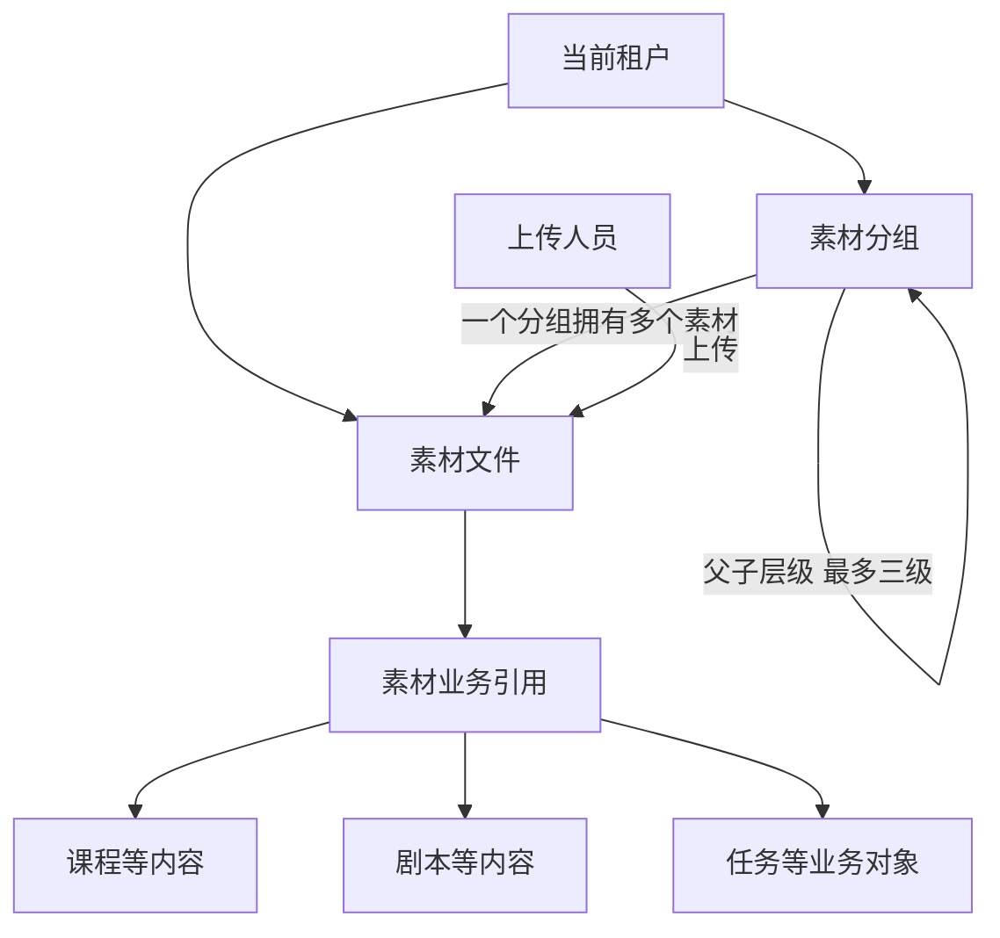
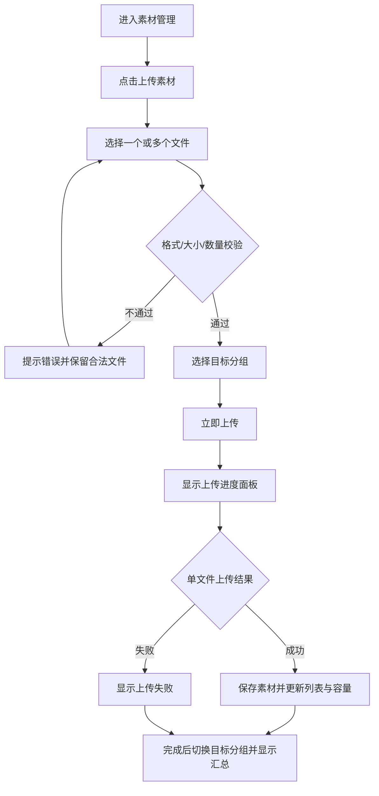

# AI陪练\_admin\_素材管理模块需求说明

**文档版本：V1.1**\
**适用端：** AI陪练客户管理后台（PC Admin）\
**需求依据：** `admin-1111(4).html`「知识库管理 → 素材管理」页面、分组弹窗、上传弹窗、上传进度面板、删除确认弹窗及对应交互。\
**文档定位：** 产品需求说明，供产品、前端、后端、测试及 Codex 理解页面与业务交互；不以原型 JavaScript 实现方式作为研发约束。

> 本文仅覆盖素材管理。HTML 中的演示文件按钮、示例素材、模拟上传速度和模拟失败率属于原型体验内容，不属于正式业务功能。已在「十、待确认事项」中明确产品方向的内容，已转化为本版正式需求；仍未明确的内容继续保留为待补充事项。原型交互与产品确认方向不一致时，以本需求文档中的产品确认方向为准。

***

# 一、需求范围与基础规则

## 1.1 模块定位

素材管理用于管理当前租户内供课程、剧本、任务等业务内容使用的文件素材。管理员可建立分组、上传文件、按分组及类型查询素材、批量移动素材、批量删除素材，并查看上传过程及存储空间使用情况。

**导航位置：** 一级导航「知识库管理」→ 二级导航「素材管理」。

## 1.2 页面清单

| 页面/弹层  | 页面类型            | 入口                 | 核心功能                      |
| ------ | --------------- | ------------------ | ------------------------- |
| 素材管理首页 | 列表页（分组树 + 素材卡片） | 知识库管理 → 素材管理       | 分组浏览、素材查询、全选、批量移动/删除、存储用量 |
| 新建分组   | 弹窗表单            | 左侧「+ 新建分组」         | 创建顶级或下级分组                 |
| 删除分组确认 | 确认弹窗            | 分组节点「删除」           | 校验分组及下级是否含素材，确认删除         |
| 上传素材   | 上传弹窗            | 右上角「上传素材」          | 选择文件、校验文件、选择目标分组、开始上传     |
| 上传进度面板 | 右下角悬浮面板         | 开始上传后自动出现          | 单文件进度、成功/失败数量、速度、折叠/关闭    |
| 批量移动   | 列表页内操作          | 勾选素材 → 选择目标分组 → 移动 | 修改所选素材所属分组                |
| 批量删除确认 | 确认弹窗            | 勾选素材 → 删除          | 二次确认、已引用素材提示、执行删除         |

**不单独设置素材详情页、编辑页：** 当前原型点击素材卡片表示勾选，不会进入详情、预览或编辑页。因此本期文档不将素材详情、重命名、下载、在线预览视为原型已确认功能。

## 1.3 功能与数据范围

1. 素材和素材分组均属于当前租户，默认只允许在当前租户范围内使用、检索与管理。
2. 素材与分组为两个独立业务对象：一个素材当前归属于一个分组；分组可具有父子关系。
3. 分组支持最多三级。一级分组的上级为「顶级分组」，二、三级分组分别归属其上一级。
4. 「全部素材」是汇总入口，不是实际分组；「未分组」是固定的默认归属，不允许删除。
5. 选择一个分组时，页面展示该分组及所有下级分组的素材。
6. 支持图片、文档、视频、音频及归入“文档”类型的压缩包上传；文件格式和大小限制见第五章。
7. 素材支持多选、批量移动和批量删除；删除时如存在业务引用，应展示被引用信息及风险提示。
8. 页面存储统计沿用原型展示方式；租户/套餐存储额度由后续 SaaS 管理后台配置，本期不建设额度配置及超限管理，原型中的 50GB 仅为演示值，不得作为正式固定额度。
9. 原型中的新增、移动、删除、上传均由浏览器临时数据演示；正式产品应实现相同的业务结果与页面数据同步。素材及分组删除均采用逻辑删除，本期不建设回收站或恢复功能，不执行业务层物理删除。

## 1.4 核心数据关系

| 对象        | 关系说明                        |
| --------- | --------------------------- |
| 租户 → 分组   | 一个租户可维护多个分组；分组不能跨租户选择       |
| 分组 → 子分组  | 一对多；分组最多三级；子分组继承祖先分组的浏览统计范围 |
| 分组 → 素材   | 一个素材归属一个分组，一个分组可包含多个素材      |
| 素材 → 上传人员 | 记录上传人员及上传时间                 |
| 素材 → 业务内容 | 素材可被课程、剧本、任务等内容引用；删除需识别引用关系 |

***

# 二、素材管理首页

**页面类型：** 列表页（左侧分组树、右侧筛选工具栏和卡片网格）。

## 2.1 页面布局及组成

**左侧分组区：**「全部素材」及数量、分组名称搜索框、固定「未分组」及数量、最多三级分组树、分组删除入口、新建分组按钮。

**右侧内容区：** 全选、清空已选、素材类型筛选、素材名称输入、查询按钮、存储空间使用信息、按需展示批量操作条、素材卡片网格、无素材时空状态。

**页面右上角：**「上传素材」主操作按钮。

## 2.2 左侧分组区字段

| 字段/元素   | 类型    | 必填 | 规则/说明                  |
| ------- | ----- | -: | ---------------------- |
| 全部素材    | 固定树节点 |  - | 点击后查看当前租户全部素材；数量为全部素材数 |
| 分组名称搜索  | 文本输入  |  否 | 根据输入关键字匹配分组名称；原型支持即时搜索 |
| 未分组     | 固定树节点 |  - | 查看未归入自定义分组的素材；不支持删除    |
| 分组名称    | 树节点文本 |  是 | 展示分组名称，可选中             |
| 分组内素材数量 | 数字展示  |  - | 统计当前分组及全部下级分组内素材数      |
| 展开/收起按钮 | 图标操作  |  - | 仅有子分组时显示，展开或收起下级       |
| 删除分组    | 文字操作  |  - | 鼠标移入自定义分组时显示；进入删除确认逻辑  |
| 新建分组    | 按钮    |  - | 点击打开新建分组弹窗             |

### 左侧分组交互

1. 默认进入「全部素材」，展示当前租户全部素材。
2. 点击「未分组」仅展示未分组素材。
3. 点击自定义分组展示该分组及其全部子分组的素材，分组计数同步反映同一范围。
4. 展开/收起仅影响树节点显示，不改变当前选中分组。
5. 切换分组时清空当前已勾选素材，避免跨分组误操作。
6. 分组名称搜索根据关键字匹配树节点；搜索命中节点时，必须同时展示该节点从顶级分组到自身的完整父级路径，避免只显示子节点导致层级关系不清楚；相关父级节点自动展开。
7. 分组搜索清空后恢复分组树正常展示。
8. 自定义分组可操作删除；「全部素材」「未分组」不显示删除入口。

## 2.3 右侧筛选与工具栏字段

| 字段/元素   | 类型   | 必填 | 规则/说明                   |
| ------- | ---- | -: | ----------------------- |
| 全选      | 复选框  |  否 | 仅全选当前分组、类型及名称过滤后可见的素材   |
| 清空已选    | 文字按钮 |  否 | 清空全部已勾选素材               |
| 素材类型    | 单选下拉 |  否 | 全部类型、图片、视频、文档、音频；默认全部类型 |
| 素材名称    | 文本输入 |  否 | 按名称关键字模糊匹配，不区分英文大小写     |
| 查询      | 按钮   |  - | 根据当前分组、类型和名称刷新卡片结果      |
| 存储已用百分比 | 数值   |  - | 已用存储容量 / 租户总容量，原型展示两位小数 |
| 已用空间    | 容量展示 |  - | 根据当前素材文件大小汇总            |
| 总存储空间   | 容量展示 |  - | 原型展示 50GB，正式额度来源待确认     |
| 上传素材    | 按钮   |  - | 打开上传素材弹窗                |

### 筛选交互

1. 分组、素材类型、素材名称组合过滤，结果取交集。
2. 类型筛选改变后即刷新内容；名称在输入框填写后点击「查询」刷新结果。
3. 查询无数据时展示「暂无素材，可点击右上角『上传素材』添加」。
4. 点击「全选」仅选择当前可见过滤结果；再次取消可解除本次可见结果的选中。
5. 点击「清空已选」取消所有已勾选素材。
6. 已选素材数大于零时展示批量操作条；没有勾选时隐藏。
7. 存储用量随成功上传和删除素材更新。移动分组不改变总存储用量。

## 2.4 素材卡片字段

| 字段    | 类型     | 必填/校验 | 说明                          |
| ----- | ------ | ----- | --------------------------- |
| 素材ID  | 系统标识   | 系统生成  | 素材唯一标识，支撑选择和引用关联            |
| 素材名称  | 文本     | 必填    | 原型以文件名展示；过长时省略，悬停可看全名       |
| 素材类型  | 枚举标签   | 必填    | 图片、视频、文档、音频                 |
| 文件大小  | 容量显示   | 必填    | KB、MB、GB自动换算                |
| 卡片缩略区 | 类型化预览区 | -     | 当前原型为按类型显示色块及图标，不是真实文件内容缩略图 |
| 勾选框   | 复选框    | 否     | 标记当前素材是否选中                  |
| 所属分组  | 关联字段   | 必填    | 由素材记录维护，页面按分组筛选展示           |
| 上传人   | 文本     | 系统生成  | 原型样例数据已记录，卡片当前未显示           |
| 上传时间  | 日期时间   | 系统生成  | 原型样例数据已记录，卡片当前未显示           |
| 引用对象  | 关联记录集合 | 可为空   | 原型用于删除时风险提示，默认卡片不展示         |

**卡片点击规则：** 点击卡片主体或复选框均切换选中/未选中；不进入素材详情页。

## 2.5 批量操作栏

| 字段/操作 | 类型  |    必填 | 交互规则                |
| ----- | --- | ----: | ------------------- |
| 已选数量  | 数字  |     - | 实时显示所选素材数           |
| 移动到分组 | 下拉框 | 移动时必选 | 列出未分组及全部自定义分组，按层级缩进 |
| 移动    | 按钮  |     - | 将当前所选素材移动至目标分组      |
| 删除    | 按钮  |     - | 打开批量删除确认弹窗          |

**不包含的功能：** 原型没有单独实现批量下载、文件重命名、素材编辑、素材详情页、移动后的撤销操作。

***

# 三、素材分组管理

## 3.1 分组规则

1. 分组最多三级，允许创建多个同级分组。
2. 分组名称最长20个字符。
3. 同一上级分组下名称不能重复；不同父分组下允许重名。
4. 新建分组必须选择上级分组位置，可选择「顶级分组」或已有一、二级分组。
5. 三级分组不可再创建下级分组。
6. 「未分组」为固定分组，不允许删除，也不可作为新建分组的父分组。
7. 「全部素材」是汇总入口，不是可选的上级分组。
8. 分组支持新增及删除；当前原型没有分组重命名、分组移动/调整父级功能。
9. 删除分组前检查当前分组及全部下级分组的素材数量。

## 3.2 新建分组弹窗

**页面类型：** 弹窗。\
**触发入口：** 左侧分组树「+ 新建分组」。

### 字段说明

| 字段   | 类型   | 必填 | 校验                         | 含义                |
| ---- | ---- | -: | -------------------------- | ----------------- |
| 分组名称 | 文本输入 |  是 | 非空、去除首尾空格、最长20字符、同父分组下不可重复 | 新分组名称             |
| 上级分组 | 单选下拉 |  否 | 未选择时为顶级分组；选择时只允许一、二级分组     | 新分组归属位置           |
| 错误提示 | 文本   |  - | 仅在校验失败时展示                  | 展示重复、为空或超出层级限制等原因 |
| 取消   | 按钮   |  - | -                          | 关闭弹窗，不创建分组        |
| 确定   | 主按钮  |  - | 所有校验通过                     | 创建新分组             |

### 页面交互

1. 从「全部素材」或「未分组」点击新建，默认上级为「顶级分组」。
2. 当前选中具体自定义分组时，默认将该分组作为上级。
3. 如果默认上级已是第三级，弹窗提示不能继续创建下级，用户可重新选择有效上级。
4. 输入分组名称时清理原有名称必填错误提示。
5. 切换上级分组时重新校验三级上限。
6. 点击「确定」依次校验：名称非空 → 上级层级有效 → 当前父分组下名称不重复。
7. 校验失败则保持弹窗打开并展示错误原因。
8. 创建成功后关闭弹窗，更新左侧分组树；存在上级时自动展开父分组，并提示创建成功。
9. 点击「取消」或关闭按钮不创建分组。

## 3.3 删除分组确认弹窗

**页面类型：** 二次确认弹窗。\
**触发入口：** 鼠标移到自定义分组 →「删除」。

### 页面元素

| 字段/元素  | 类型     | 规则               |
| ------ | ------ | ---------------- |
| 分组名称   | 文本展示   | 展示当前待删除分组        |
| 下级分组数  | 数字/提示  | 存在子分组时显示连带删除数量   |
| 关联素材数  | 计算值/提示 | 计算当前分组及全部下级分组素材数 |
| 删除风险提示 | 文本     | 原型提示“删除后不可恢复”    |
| 取消     | 按钮     | 关闭弹窗，不删除         |
| 确定     | 危险操作按钮 | 通过校验后执行删除        |

### 删除规则与交互

1. 固定「未分组」和汇总入口「全部素材」不能删除。
2. 删除目标分组前检查其自身及全部子分组是否存在素材。
3. 若存在任意素材，阻止删除并提示「该分组下仍有 N 个素材，请先移动或删除」。
4. 若素材数为0，弹出确认框。
5. 如果存在子分组，确认文案显示「含 N 个子分组」，用户确认后同步删除空分组子树。
6. 删除成功后刷新分组树及数量；若当前正选中被删除分组或其下级，则切换回「全部素材」。
7. 用户取消后不执行删除。
8. 分组删除采用逻辑删除：删除后正常分组树、分组选择下拉及业务查询中不再展示该分组；本期不提供回收站、恢复入口，不执行物理删除。
9. 删除分组仍需满足当前分组及其全部下级分组均无素材；存在素材时先阻止删除。

***

# 四、素材批量操作

## 4.1 勾选与全选

1. 点击素材卡片任意非独立控件区域，切换当前素材选中状态。
2. 点击卡片左上角复选框，达到相同效果。
3. 已选素材高亮描边，工具栏展示「已选 N 项」。
4. 「全选」操作范围为当前筛选结果，不是当前租户所有素材。
5. 「清空已选」清空全部选择；切换分组时同样清空选择。
6. 分组、类型及名称筛选同时存在时，全选范围为其交集结果。

## 4.2 批量移动

**入口：** 勾选一个或多个素材 → 选择「移动到分组…」→「移动」。

### 字段说明

| 字段    | 类型  | 必填 | 规则            |
| ----- | --- | -: | ------------- |
| 已选素材数 | 数字  |  - | 大于0时才展示批量操作条  |
| 目标分组  | 下拉框 |  是 | 支持未分组及全部自定义分组 |
| 移动    | 按钮  |  - | 更新所有已选素材归属分组  |

### 页面交互

1. 没有选择目标分组时点击移动，提示「请选择目标分组」。
2. 选定目标分组后点击移动，更新所选素材的分组归属。
3. 移动成功后提示「已将 N 个素材移动到『目标分组』」。
4. 清空选择状态并刷新当前分组及其下级的素材展示和分组统计。
5. 素材ID、文件名、大小、类型和业务引用关系均不因移动分组而改变。
6. 移动不会删除文件，不改变租户已用总存储空间。
7. 原型未提供移动确认框、撤销移动或移动操作记录页面，不额外要求页面实现。

## 4.3 批量删除

**入口：** 勾选一个或多个素材 →「删除」→ 二次确认弹窗。

### 页面字段

| 字段/元素  | 类型   | 规则                        |
| ------ | ---- | ------------------------- |
| 待删除素材数 | 数字   | 显示当前选择的素材总数               |
| 被引用素材数 | 数字   | 所选素材中已被业务内容引用的数量          |
| 引用业务对象 | 列表   | 展示被引用素材及其引用方，如课程、剧本、任务    |
| 风险提示   | 文本   | 若存在引用关系，提示删除后相关内容可能无法正常展示 |
| 取消     | 按钮   | 关闭弹窗，无数据变更                |
| 确定     | 危险按钮 | 执行素材删除                    |

### 页面交互

1. 没有选择素材时不能进入有效删除流程，提示先勾选。
2. 若所选素材均未被引用，弹出普通二次确认，显示「确定删除已选的 N 个素材？删除后不可恢复」。
3. 若包含已引用素材，确认弹窗增加醒目的「素材已被引用」提示，列出受影响素材及引用方。
4. 已被引用素材允许删除。确认弹窗展示引用风险及引用对象，但不因存在引用关系而禁止用户继续删除。
5. 素材删除采用逻辑删除：删除后从正常素材列表、分组计数及后续素材选择入口中移除；本期不建设回收站或恢复功能，不执行物理删除。
6. 删除后清空勾选并刷新列表及相关数量，提示删除成功。存储用量的统计口径需区分业务可用素材与底层实际占用空间，具体扣减时点仍需结合存储实现明确。
7. 用户取消则保留全部所选素材。
8. 删除已引用素材后，原引用内容如何呈现、是否保留引用占位或由业务模块提示异常，由后续业务逻辑补充；素材管理模块本期不负责逐一改造课程、剧本、任务等引用方。
9. 逻辑删除不等于物理删除；文件对象的实际清理策略不属于本期素材管理页面功能。

***

# 五、上传素材

## 5.1 上传弹窗

**页面类型：** 大型弹窗。\
**触发入口：** 素材管理首页右上角「上传素材」。

**布局：** 左侧选取文件操作区；右侧支持格式与大小说明；下方为待上传文件列表、上传目标分组及提交按钮。

## 5.2 上传字段说明

| 字段/元素   | 类型     |        必填 | 校验/规则               | 含义           |
| ------- | ------ | --------: | ------------------- | ------------ |
| 选取文件    | 文件选择按钮 | 是（至少一个文件） | 系统文件选择器支持多选         | 打开本地文件选择     |
| 文件名     | 文件信息展示 |      系统生成 | 根据本地文件名获取           | 待上传文件识别名称    |
| 文件类型    | 枚举标签   |      系统生成 | 根据扩展名映射图片/视频/文档/音频  | 后续素材类型       |
| 文件大小    | 容量展示   |      系统生成 | 根据本地文件大小换算          | 用于上传限制计算     |
| 移除待上传文件 | 操作图标   |         - | 删除待上传列表中的指定文件       | 不影响已存素材      |
| 待上传数量   | 数字展示   |      系统计算 | 不超过20个              | 当前选取文件数量     |
| 待上传总大小  | 容量展示   |      系统计算 | 不超过3GB              | 当前批次文件总量     |
| 上传至     | 单选下拉   |         是 | 默认当前选中分组；全部素材时默认未分组 | 文件上传完成后的所属分组 |
| 文件校验错误  | 错误文案   |         - | 格式/大小/数量不合法时显示      | 提示无法添加原因     |
| 立即上传    | 主按钮    |         - | 至少有1个待上传文件且校验通过     | 开始上传任务       |
| 取消/关闭   | 关闭图标   |         - | -                   | 关闭上传弹窗       |

## 5.3 支持文件类型及限制

**以下格式、单文件大小限制及批量限制均来自当前 HTML 原型。**

| 素材类型 | 支持扩展名                          | 单文件最大限制 | 列表分类      |
| ---- | ------------------------------ | ------: | --------- |
| 图片   | jpeg、jpg、png、gif               |  10MB以内 | 图片        |
| 文档   | docx、doc、xlsx、xls、ppt、pptx、pdf | 100MB以内 | 文档        |
| 视频   | mp4、mov、3gp                    |   3GB以内 | 视频        |
| 音频   | mp3、wav                        |   2GB以内 | 音频        |
| 压缩包  | zip、rar                        |   2GB以内 | 原型按「文档」分类 |

**批次限制：** 一次性选择不超过20个文件；一批文件总大小不超过3GB。

**容量规则：** 页面原型显示租户总空间50GB。是否固定50GB、达到容量后是否禁止上传，以及文件大小单位按十进制还是二进制计算，均需产品确认。

## 5.4 上传弹窗交互

1. 点击「上传素材」打开弹窗，初始化待上传列表及错误提示。
2. 默认上传位置：如果当前浏览的是「全部素材」，默认「未分组」；如果当前选择了「未分组」或自定义分组，则默认该分组。
3. 点击「选取文件」打开系统文件选择器，可一次选择多个文件。
4. 文件加入待上传列表时逐个校验扩展名、单文件大小、已选数量和批次总大小。
5. 不符合规则的文件不加入待上传列表，并展示对应错误信息。
6. 同一待上传批次中重复选择同名文件时，不重复加入待上传列表。若上传目标分组中已存在同名素材，则自动重命名后上传：在原文件名主体后增加「（*）」标识，并保留原文件扩展名；「*」由系统生成可区分的标识，避免覆盖已有素材。若重命名后仍发生冲突，系统需继续生成唯一名称。
7. 待上传列表展示文件类型、文件名、大小及删除图标，底部展示总数量和总大小。若文件因目标分组内同名而需重命名，应在上传前或上传结果中明确展示最终保存名称。
8. 点击文件右侧删除图标，只从当前待上传列表移除该文件。
9. 上传前允许修改「上传至」分组，列表展示「未分组」及全部自定义分组。
10. 点击「立即上传」时，如没有文件，提示「请先点击『选取文件』选择要上传的文件」。
11. 校验通过后关闭上传弹窗，打开右下角上传进度面板。
12. 点击弹窗关闭图标，终止当前弹窗操作；本次尚未提交的待上传列表按重新打开时清空的原型交互处理。
13. 「添加示例文件（演示）」仅供 HTML 演示，不纳入正式产品。

## 5.5 上传进度面板

**页面类型：** 右下角悬浮进度面板。

### 字段说明

| 字段/元素  | 类型       | 含义                     |
| ------ | -------- | ---------------------- |
| 进度面板标题 | 文本       | 上传中 N/总数，全部结束后显示上传完成   |
| 上传速度   | 容量/秒     | 显示上传速度，原型以KB/s或MB/s表示  |
| 总体进度   | 百分比/进度背景 | 本批次文件已完成的总体进度          |
| 文件类型标识 | 图标/后缀    | 每个文件显示类型图标及后缀          |
| 文件名    | 文本       | 本批次对应文件名称              |
| 已传/总大小 | 数值       | 当前文件已上传量及总大小           |
| 单文件进度  | 百分比/环形进度 | 每个文件上传过程完成度            |
| 上传状态   | 枚举/文案    | 等待上传、上传中、上传成功、上传失败     |
| 成功数量   | 数字       | 本批次成功上传文件数             |
| 失败数量   | 数字       | 本批次上传失败文件数             |
| 折叠/展开  | 按钮       | 收起或展开进度明细，不影响已保存的上传结果  |
| 关闭     | 按钮       | 上传进行中点击后弹出「是否终止上传？」二次确认；上传完成后可直接关闭 |

### 页面交互

1. 提交上传后，显示进度面板及每个文件的等待/上传中状态。
2. 单文件进度更新时同步更新上传大小、百分比及总体进度。
3. 每个文件完成后标记上传成功或失败。
4. 上传成功的文件进入目标分组，素材列表可实时刷新看到新增记录。
5. 全部文件处理结束后，面板标题变为「上传完成」，展示成功及失败数量。
6. 上传完成后自动切换当前分组到上传目标分组，便于查看新增素材。
7. 失败文件显示「上传失败，请检查网络后重试」，并提供该文件的「重试」按钮；点击后仅重新上传该失败文件，不重复上传已成功文件。
8. 当本批次存在失败文件时，进度面板提供「重试失败（N）」快捷操作；点击后重新上传当前批次全部失败文件，已成功文件不重复上传。
9. 可折叠/展开明细；折叠不应改变当前任务结果。
10. 上传进行中点击关闭按钮，弹出二次确认：「是否终止上传？」并说明关闭将终止本次上传，已上传成功的素材会保留在列表中。点击取消则继续上传并保留面板；点击确定则终止当前上传任务并关闭面板。
11. 终止上传时，已成功上传的文件保留；尚未完成的文件不作为成功素材入库。中止后不自动续传，用户可重新发起上传。
12. 全部文件处理结束后，面板可直接关闭，不再提示终止上传。
13. 上传成功后，素材名称、类型、大小、分组、上传人及上传时间应在素材记录中可追溯。

***

# 六、关键业务流程

## 6.1 上传并归类素材

## 6.2 新建分组并上传

素材管理 → 选择现有分组或全部素材 → 新建分组 → 输入名称及选择上级 → 校验三级层级与同级重名 → 保存分组 → 上传素材 → 上传至目标分组 → 成功后在该分组查看素材。

## 6.3 批量移动素材

进入素材管理 → 选择分组/筛选类型和名称 → 勾选多个素材 → 选择目标分组 → 点击移动 → 校验目标分组 → 更新素材所属分组 → 更新列表及分组计数 → 清空选择。

## 6.4 批量删除素材

进入素材管理 → 勾选素材 → 点击删除 → 检查选中素材的引用关系 → 无引用时显示普通确认；存在引用时显示引用对象及风险 → 用户取消或确认 → 确认后逻辑删除素材并刷新列表及相关统计；本期不进入回收站、不物理删除文件。

## 6.5 删除分组

选择自定义分组 → 点击删除 → 检查当前分组及全部下级分组素材数 → 有素材则提示先移动或删除 → 无素材则二次确认（含子分组数） → 确认后逻辑删除空分组子树 → 从正常分组树及分组选择入口移除，不提供恢复。

***

# 七、异常与业务校验

| 场景             | 原型交互/应达到的业务效果                  |
| -------------- | ------------------------------ |
| 分组名称为空         | 禁止创建，提示请输入分组名称                 |
| 同一父分组下名称重复     | 禁止创建，提示已存在同名分组                 |
| 三级分组下继续新增下级    | 禁止创建，提示最多支持三级分组                |
| 删除有素材的分组       | 禁止删除，提示该分组及下级仍有N个素材            |
| 删除没有素材但有子分组的分组 | 提示连带删除的子分组数量，确认后删除分组树          |
| 删除固定「未分组」      | 不展示删除操作，不允许删除                  |
| 当前筛选没有素材       | 展示空状态和上传素材入口                   |
| 未选素材点击批量删除     | 提示先勾选素材                        |
| 未选目标分组点击移动     | 提示请选择目标分组                      |
| 删除素材存在业务引用     | 显示被引用素材、引用方及影响风险；允许确认后继续逻辑删除，引用方后续补充处理逻辑 |
| 未选择上传文件        | 提示先选取文件，不开始上传                  |
| 文件后缀不支持        | 提示不支持的文件类型，不加入待上传列表            |
| 单文件大小超限        | 提示具体文件及类型大小上限                  |
| 上传文件超过20个      | 提示一次性选择不超过20个                  |
| 批次总大小超过3GB     | 提示多个文件合计不能超过3GB                |
| 当前待上传批次重复添加同名文件 | 跳过重复文件，不重复加入待上传列表              |
| 目标分组已存在同名素材     | 自动在文件名主体后增加「（*）」并保留扩展名，生成不冲突的新名称 |
| 上传某文件失败        | 进度面板标记失败，提供单文件重试，并汇总失败数量       |
| 本批次存在失败文件       | 提供「重试失败（N）」操作，仅重新上传失败文件        |
| 上传中点击关闭面板       | 弹出终止确认；确认后停止未完成任务，已成功文件保留；取消则继续上传 |
| 上传部分成功、部分失败    | 成功文件入列，失败文件保持失败状态，总结成功/失败数量    |
| 上传完成           | 自动切换到目标分组，并刷新素材数量和存储已用空间       |
| 分组切换           | 清除已选素材，刷新当前分组素材                |

***

# 八、权限、数据范围及素材引用

## 8.1 权限控制

沿用已确认的统一角色体系，不新增角色类型。素材管理可使用系统已有的固定功能权限点进行配置。建议权限点如下，是否逐项独立提供取决于最终权限清单：

| 权限点  | 控制对象           |
| ---- | -------------- |
| 素材查看 | 进入素材管理、浏览素材及分组 |
| 分组新增 | 打开新建分组并提交      |
| 分组删除 | 删除自定义分组        |
| 素材上传 | 打开上传弹窗并提交文件    |
| 素材移动 | 将已选素材移动至其他分组   |
| 素材删除 | 删除单个或批量所选素材    |

**说明：** HTML 原型未体现按角色禁用按钮、不同组织范围素材可见性以及权限不足提示。上述权限点属于结合现有权限体系的衔接建议，不能直接认定为已在原型中实现。

## 8.2 租户与组织范围

1. 素材、分组归属于当前租户，跨租户不可直接浏览、移动或删除。
2. 产品已确认不需要组织级素材授权；同一租户内素材按租户范围统一管理，不按组织隔离或单独授权。
3. 不建设组织级素材授权页面、组织范围字段及跨组织授权配置。

## 8.3 业务引用关系

1. 素材可被课程、剧本、任务等业务内容引用。原型使用素材记录中的引用对象列表判断删除风险。
2. 删除已引用素材时，应在弹窗中展示哪些素材被哪些内容引用。
3. 已引用素材允许删除；删除前仅展示风险提示，不因存在引用关系而阻止删除。
4. 素材移动分组不应改变素材ID及原有引用关系。
5. 引用关系覆盖所有可能引用素材的业务来源，不限于课程、剧本、任务；具体业务模块清单、引用关系接口及删除后的引用方处理方式仍待补充确认。

## 8.4 存储空间

1. 页面在列表工具栏显示已用百分比及「已用 / 总量」。
2. 原型总空间为50GB，已用量依据当前素材记录大小汇总。
3. 上传成功增加素材已用量；移动分组不改变已用量。素材逻辑删除后，业务可用素材统计应扣除已删除记录；底层文件尚未物理删除，实际存储占用是否同步扣减需按存储统计口径处理，不得将逻辑删除描述为物理释放空间。
4. 租户及套餐存储额度后续统一配置在 SaaS 管理后台，本期不建设额度配置、套餐配额管理及超限拦截。原型中的 50GB 仅为演示值，正式环境不得将其写死为固定额度。

***

# 九、与最新HTML原型的对齐及未覆盖内容

| 编号  | 原型表现                 | 文档处理方式               |
| --- | -------------------- | -------------------- |
| M01 | 一级知识库管理下有「素材管理」菜单    | 直接纳入导航范围             |
| M02 | 左侧有全部素材、未分组、自定义三级分组  | 按原型定义页面和分组规则         |
| M03 | 分组支持搜索、展开/收起、删除、新建   | 按原型定义交互              |
| M04 | 不支持编辑或重命名分组          | 不擅自增加分组编辑页           |
| M05 | 右侧可按类型、名称筛选素材        | 按原型定义筛选字段            |
| M06 | 点击卡片是勾选素材            | 不擅自增加素材详情页           |
| M07 | 批量移动支持选择目标分组         | 按原型定义数据变更和刷新         |
| M08 | 删除已引用素材仅提示风险，仍允许继续   | 已确认允许删除；引用方后续补充处理逻辑 |
| M09 | 上传弹窗有文件格式/大小说明       | 保留原型限制值              |
| M10 | 原型中「添加示例文件」仅供演示      | 明确排除正式业务需求           |
| M11 | 上传进度由演示数据及模拟失败状态驱动   | 仅提炼界面状态和结果，不照搬模拟机制   |
| M12 | 上传面板提供折叠、关闭；新版增加单文件重试、重试失败批次及终止确认 | 按新版交互纳入需求；随机失败和模拟进度仅为演示机制 |
| M13 | 当前素材卡片只有类型图标而非真实文件预览 | 不要求本期增加在线预览          |
| M14 | 50GB为原型展示容量          | 已确认额度后续由 SaaS 管理后台按租户/套餐配置，本期不做配额管理 |
| M15 | 角色操作权限、组织级素材授权未体现在页面 | 已确认不做组织级授权；权限配置后续再补充，本期保留提醒 |
| M16 | 素材删除和分组删除都显示不可恢复     | 已确认素材及分组均逻辑删除；本期无回收站/恢复功能，不物理删除 |

***

# 十、产品确认结论与待补充事项

本章将原「待确认事项」拆分为已确认方向和仍需补充的事项。已确认方向属于本版本正式需求，研发、测试及 Codex 应按确认结论实现；仍需补充的事项不得自行假设，后续由产品补齐。

## 10.1 已确认产品方向

| 编号 | 事项 | 产品确认方向 | 本期需求落地规则 |
| --- | --- | --- | --- |
| MAT01 | 已被引用素材是否允许删除 | 允许删除，后面业务逻辑中再做补充 | 删除前展示引用对象及风险提示；用户确认后允许逻辑删除，不由素材管理模块阻止删除。引用方的异常展示、占位或修复机制由后续业务模块补充。 |
| MAT02 | 素材删除方式 | 逻辑删除，不要物理删除，本期功能不加回收站 | 删除后从正常素材列表及选择入口隐藏，数据记录标记为已删除；本期不提供回收站、恢复入口，不执行物理删除。 |
| MAT03 | 分组删除方式 | 逻辑删除，本期无恢复功能 | 空分组及其空子分组树采用逻辑删除；正常分组树及分组选择入口不再展示；本期不提供恢复功能。含素材分组仍禁止删除。 |
| MAT04 | 上传面板关闭行为 | 关闭需要终止上传，给提示「是否终止上传？」；确定就是终止 | 上传进行中点击关闭，先二次确认；取消则继续上传，确定则终止本批次未完成任务并关闭面板，已成功上传的文件保留。 |
| MAT05 | 上传失败后的重新上传 | 补充重试按钮 | 每个失败文件提供单文件「重试」；存在失败文件时提供「重试失败（N）」批量操作。仅重试失败文件，已成功文件不重复上传。 |
| MAT06 | 同名素材上传 | 重命名，在原名字后面加「（*）」 | 目标分组内存在同名文件时，系统自动在文件名主体后追加「（*）」标识，保留扩展名，不覆盖原文件；系统生成可区分标识以保证名称唯一。 |
| MAT07 | 存储容量与超限 | 按租户、套餐等配置，后面加到 SaaS 管理后台中，本期不考虑 | 本期不建设租户/套餐额度配置及超限管理；原型 50GB 仅为演示值，不作为正式固定配额。 |
| MAT08 | 素材按组织授权 | 不需要 | 素材按租户范围统一管理，不做组织级隔离、授权及跨组织授权配置。 |
| MAT11 | 压缩包的素材类型 | 不用加 | zip/rar 继续归入「文档」类型，不新增「压缩包」筛选类型。 |
| MAT13 | 上传文件总大小和类型判定 | 按扩展名判断 | 文件类型按扩展名映射及校验；本期需求按原型扩展名规则执行。 |

## 10.2 仍需补充确认的事项

| 编号 | 待补充事项 | 当前已知信息 | 后续需要补充的内容 |
| --- | --- | --- | --- |
| MAT09 | 素材管理操作权限 | 产品确认权限配置最后再考虑 | 本期保留提醒。后续需补充查看、分组新增/删除、素材上传/移动/删除等权限点，以及角色与权限点的对应关系。 |
| MAT10 | 素材详情、下载、预览与手动重命名 | 产品确认本期不考虑 | 本期不纳入需求范围；后续如需增加，再单独补充页面、操作权限和文件访问规则。注意：MAT06 的同名自动重命名属于上传冲突处理，不代表开放手动重命名。 |
| MAT12 | 删除引用提示覆盖的业务资源范围 | 产品确认覆盖所有业务源，但具体有哪些引用尚不确定 | 保留待办。需梳理全部可引用素材的业务模块、引用对象标识、引用关系查询接口及删除后的业务处理责任方。 |
| MAT14 | 分组搜索树展示 | 产品确认搜索命中时需要保留父级路径 | 需求已明确：命中节点及其从顶级到自身的父级路径均展示，父级自动展开。新版 HTML 当前搜索实现仍需核对并补齐父级路径显示逻辑。 |

## 10.3 原型与确认方向的差异提醒

1. **同名文件自动重命名：** 产品方向已确认，但新版 HTML 当前上传校验代码仅处理同一待上传批次内重复文件的跳过逻辑，尚未体现与目标分组已有素材重名时自动追加「（*）」的处理。需补充原型交互或在研发实现中按本章规则执行。
2. **逻辑删除：** HTML 演示代码通过前端数组移除记录模拟删除；正式实现必须按逻辑删除处理，不能照搬前端数组移除作为数据持久化方案。
3. **上传终止：** 新版 HTML 已增加「是否终止上传？」确认；正式实现需保证取消确认后上传继续，确认后停止未完成任务，已成功文件保留。
4. **上传重试：** 新版 HTML 已增加单文件「重试」和「重试失败（N）」操作；正式实现应由上传接口返回真实结果，不采用原型随机成功率。
5. **分组搜索：** 产品已确认保留父级路径；新版 HTML 当前通过节点名称过滤的实现可能只显示命中节点，需补齐祖先节点展示。
6. **存储额度：** 原型 50GB 为演示数据；本期不实现租户/套餐配额配置和超限拦截，不能将演示值作为正式业务限制。

***

# 十一、验收标准

1. Admin菜单「知识库管理 → 素材管理」可正常进入素材管理首页。
2. 页面显示「全部素材」「未分组」及最多三级自定义分组树。
3. 点击分组后展示该分组及其全部下级分组内素材，数量统计一致。
4. 分组可展开/收起，可按名称搜索。
5. 新建分组支持分组名称和上级分组，名称最长20字符；同父分组下不可重名。
6. 已是三级的分组不能继续新增下级。
7. 「全部素材」「未分组」不可删除。
8. 删除含素材的分组时被阻止，并准确提示分组及下级素材数。
9. 删除空分组时展示二次确认，存在子分组时提示受影响范围。
10. 类型筛选支持全部类型、图片、视频、文档、音频。
11. 素材名称支持模糊查询，可与分组、类型组合筛选。
12. 当前查询结果为空时展示明确空状态和上传入口。
13. 点击卡片或复选框可勾选素材；全选范围为当前可见筛选结果。
14. 勾选后展示已选数量和批量移动、删除操作。
15. 批量移动必须选择目标分组；移动后列表和分组计数正确刷新。
16. 批量删除必须二次确认，取消不影响任何素材。
17. 已引用素材删除时展示素材名称、引用方和风险提示；用户确认后允许逻辑删除，不因引用关系阻止删除。
18. 点击上传素材可打开上传弹窗，并可从本地批量选取文件。
19. 文件类型、单文件大小、20个文件上限和3GB批次大小按第五章规则校验。
20. 未选择文件时不能开始上传，并展示明确错误提示。
21. 上传前可以选择目标分组，默认值符合当前分组选择规则。
22. 上传进度面板展示单文件及整批状态、速度、数量和进度。
23. 单文件上传失败时提供单文件重试；存在多个失败文件时提供「重试失败（N）」批量重试，成功文件不得重复上传。
24. 上传进行中关闭进度面板时必须二次确认；取消后继续上传，确认后终止未完成任务且已成功文件保留。
25. 部分上传失败时成功文件仍正常入列，并正确展示成功/失败数量。
26. 上传完成后定位到目标分组，素材列表显示上传成功的文件。
27. 目标分组存在同名素材时自动追加「（*）」生成新名称并保留扩展名，不覆盖原文件；同一待上传批次内重复添加仍按去重规则处理。
28. 素材及分组删除均为逻辑删除；正常页面不再展示已删除记录，本期不提供回收站/恢复功能，不执行物理删除。
29. 素材上传后更新已用空间统计；逻辑删除后的统计按业务可用素材口径更新，底层实际存储释放不作为本期逻辑删除的结果承诺。
30. 存储额度不写死为50GB；本期不实现租户/套餐额度配置及超限管理。
31. 租户数据不应与其他租户混用；不实现组织级素材授权。
32. 分组搜索命中节点时，应保留并展示其完整父级路径，相关父级自动展开。
33. 原型演示文件按钮、模拟上传速度和随机失败机制不作为正式业务能力。
34. 本期不新增素材详情页、编辑页、下载页或在线预览页；同名冲突自动重命名不属于手动重命名功能。
