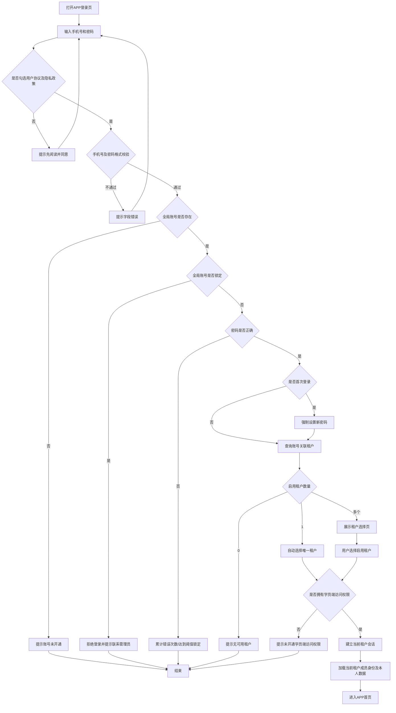

# AI陪练_app_登录模块需求说明

**文档版本：V1.0**  
**适用端：** AI陪练学员端（移动 APP）  
**需求依据：**
1. `app-merged.html`：AI陪练学员端合并版页面原型，重点参考登录页、「我的」-「账号设置」及修改密码底部弹层、退出登录交互。
2. 《AI陪练_SaaS底层基础架构与权限设计说明_V1.2》。
3. 《AI陪练_admin_登录模块需求说明_V1.1》。

> 本文仅描述学员端 APP 的登录、我的-账号设置、修改密码及退出登录。Admin PC管理后台的登录和账户操作以 Admin 专项需求文档为准。原型中的演示账号、演示密码、一键登录及任意验证码等模拟内容不作为正式需求。

---

# 一、需求范围与基础规则

## 1.1 页面清单

| 页面/弹层 | 页面类型 | 说明 |
|---|---|---|
| APP登录页 | APP登录页 | 手机号、密码、用户协议及隐私政策确认 |
| 租户选择页 | APP选择页 | 一个账号关联多个启用租户时选择进入 |
| 首次登录设置密码页 | APP表单页 | 初始密码登录后强制修改全局账号密码 |
| 我的页面 | APP一级页面 | 展示当前学员信息及个人功能入口 |
| 账号设置页 | APP二级页面 | 展示账号资料、账户安全、缓存、关于及退出登录 |
| 修改登录密码 | 底部弹层 | 输入原密码、新密码和确认新密码，修改全局账号密码 |
| 退出登录 | 页面操作 | 清理当前APP会话并返回登录页 |

**范围说明：**
- 当前 HTML 原型还包含学习、陪练、考试等业务页面，本需求不展开这些业务页面。
- 原型存在忘记密码底部弹层的相关代码，但当前登录页未呈现明确的忘记密码入口；本需求不将其纳入本期已确认页面范围。若后续需要开放自助重置密码，应单独确认入口、短信验证及安全规则。
- 原型中“清除缓存”“关于”作为账号设置页展示项，本需求描述其页面表现及基础交互边界，不扩展为复杂设备管理或版本升级需求。

## 1.2 全局账号与租户规则

1. APP使用全局账号体系，一个全局账号对应一个用户身份，以手机号和密码登录。
2. 一个全局账号可以关联多个租户；每个租户分别维护该账号的成员状态、组织归属、角色和应用访问权限。
3. 同一全局账号在同一个租户内原则上只保留一条成员关系。
4. 全局账号状态与租户成员状态独立：
   - 全局账号锁定：该账号在所有租户均无法登录。
   - 某租户成员停用：该账号不能进入该租户，但不影响其他启用租户。
5. APP登录成功后，还需校验当前租户有效性、租户成员状态及“学员端访问”权限。
6. 登录或切换租户后，只加载当前租户的成员身份及本人业务数据。
7. 首次登录修改密码、账号设置内修改密码均修改全局账号密码；修改后该账号在所有关联租户均使用新密码。
8. 学员端个人资料中的姓名、手机号、所属组织、角色等由后台管理，APP端只读展示，不提供自行修改入口。
9. APP端不提供自助注册入口，账号由租户管理员或平台开通。

## 1.3 APP登录总流程

流程约束：
- 用户协议及隐私政策必须主动勾选后才能登录。
- 首次登录修改密码在租户查询/选择之前。
- 只有一个启用租户时自动选择，不展示租户选择页。
- 多个启用租户时展示租户选择页；停用租户只展示，不允许进入。
- 进入租户前服务端再次校验租户状态、成员状态和“学员端访问”权限。
- 登录成功后会话绑定全局账号、当前租户及当前租户成员身份。

---

# 二、APP登录页

**页面类型：** 移动 APP 登录页。  
**原型布局：** 手机端纵向布局；顶部AI陪练主题插画，中部欢迎语及产品说明，下方手机号、密码输入框、协议确认和登录按钮。

## 2.1 页面字段说明

| 字段/元素 | 类型 | 必填 | 校验/规则 | 含义 |
|---|---|---:|---|---|
| 主题插画 | 图片展示 | 否 | 固定展示 | AI陪练品牌及产品形象 |
| 欢迎语 | 文本展示 | - | 固定文案 | 如“Hi ~ 欢迎登录” |
| 产品说明 | 文本展示 | - | 固定文案 | 提示使用管理员开通的账号登录 |
| 手机号 | tel文本输入 | 是 | 11位手机号格式；去除首尾空格 | 全局账号登录标识 |
| 密码 | password输入 | 是 | 不允许为空，由服务端验证 | 全局账号登录密码 |
| 显示/隐藏密码 | 图标按钮 | 否 | 点击切换明文/密文 | 改变密码展示形式 |
| 用户协议勾选 | 复选框 | 是 | 必须主动勾选 | 确认已阅读并同意协议 |
| 《用户协议》 | 文本链接 | - | 点击打开协议内容 | 展示用户协议 |
| 《隐私政策》 | 文本链接 | - | 点击打开隐私政策内容 | 展示隐私政策 |
| 登录 | 主按钮 | - | 必填及协议校验通过后可提交 | 提交全局账号认证 |
| 登录错误提示 | 错误提示区域 | - | 发生错误时展示 | 展示账号、密码、锁定等失败原因 |

## 2.2 页面交互

1. 用户输入手机号和密码。
2. 点击密码可见图标，在明文和密文之间切换；切换仅改变当前输入框展示方式。
3. 用户必须勾选“我已阅读并同意《用户协议》及《隐私政策》”后才能提交登录。
4. 点击《用户协议》或《隐私政策》分别打开对应协议内容；返回登录页后尽量保留已填写手机号、密码及勾选状态。
5. 点击“登录”后先执行前端必填、手机号格式及协议勾选校验，再提交服务端。
6. 登录过程中按钮显示加载状态，防止重复提交。
7. 登录失败在登录表单区域展示明确错误信息；关键失败原因不能只通过短暂Toast提示。
8. 密码错误时可保留手机号，密码按安全策略清空或要求重新输入。
9. 页面不提供注册入口，账号由企业管理员开通。
10. 原型中的“一键登录演示账号”仅用于产品演示，正式环境必须移除。

## 2.3 认证异常处理

| 情况 | 系统处理 |
|---|---|
| 未勾选用户协议及隐私政策 | 提示“请先阅读并同意《用户协议》和《隐私政策》” |
| 手机号格式不正确 | 提示请输入正确的11位手机号 |
| 密码为空 | 提示请输入登录密码 |
| 手机号未开通 | 提示该手机号尚未开通账号，请联系企业管理员 |
| 全局账号锁定 | 拒绝登录，提示该账号所有租户均无法登录，请联系管理员 |
| 密码错误 | 提示密码错误及剩余尝试次数 |
| 连续错误达到阈值 | 按服务端安全策略临时锁定全局账号 |
| 登录认证成功 | 进入首次改密判断及租户选择流程 |

---

# 三、首次登录设置密码页

**页面类型：** APP表单页。  
**触发条件：** 全局账号使用初始密码登录，认证服务返回首次登录改密标记。

## 3.1 页面字段说明

| 字段 | 类型 | 必填 | 校验/规则 | 含义 |
|---|---|---:|---|---|
| 页面标题 | 文本展示 | - | 固定文案 | 设置登录密码 |
| 页面说明 | 文本展示 | - | 固定文案 | 首次登录请设置新密码，设置后妥善保管 |
| 密码规则提示 | 提示区域 | - | 固定规则 | 新密码需8位以上，且同时包含字母与数字 |
| 新密码 | password输入 | 是 | 至少8位，且同时包含英文字母和数字 | 正式登录密码 |
| 确认新密码 | password输入 | 是 | 必须与新密码一致 | 确认密码 |
| 确认并设置 | 主按钮 | - | 字段校验通过后可提交 | 提交全局密码修改 |
| 返回登录 | 文本/按钮 | - | - | 终止本次登录流程并返回登录页 |

## 3.2 页面交互

1. 展示首次登录改密说明和密码规则。
2. 用户填写新密码、确认新密码。
3. 点击“确认并设置”后执行前端校验：新密码长度、字母数字组合、两次输入一致。
4. 服务端再次校验并更新全局账号密码。
5. 成功后清除全局账号首次登录标记，并继续查询租户及后续登录流程。
6. 失败时停留当前页并显示错误原因。
7. 不允许跳过首次改密直接进入学员端。
8. 点击“返回登录”终止本次登录流程，返回登录页；已输入的新密码不应被保存。

## 3.3 业务规则

1. 首次登录改密属于全局账号级操作，不是当前租户独立密码。
2. 修改成功后，该账号在所有关联租户均使用新密码。
3. 修改密码不改变账号关联租户、租户成员状态、组织归属、角色及学员端访问权限。
4. 首次登录标记由认证服务维护，不能由客户端自行清除。

---

# 四、租户选择页

**页面类型：** APP选择页。  
**触发条件：** 全局账号认证成功且首次改密完成后，账号存在两个及以上启用租户成员关系。

## 4.1 页面字段说明

| 字段 | 类型 | 必填 | 校验/规则 | 含义 |
|---|---|---:|---|---|
| 页面标题 | 文本展示 | - | 固定文案 | 选择要进入的企业 |
| 页面说明 | 文本展示 | - | 固定文案 | 提示账号关联多个企业，选择本次进入的租户 |
| 租户名称 | 文本展示 | 是 | 服务端返回 | 当前账号关联的租户名称 |
| 应用名称 | 文本展示 | 是 | 固定显示学员端 | 当前登录入口 |
| 当前成员角色 | 文本/标签 | 否 | 服务端返回 | 当前账号在该租户内的角色摘要 |
| 成员状态 | 状态标签 | 是 | 启用/停用 | 当前租户成员状态 |
| 租户卡片 | 可点击卡片 | 是（启用租户） | 停用状态不可点击 | 选择本次进入的租户 |
| 返回登录 | 文本按钮 | - | - | 返回APP登录页 |

## 4.2 页面交互

1. 展示当前全局账号关联的租户列表。
2. 启用租户可点击；停用租户置灰并标记“成员已停用”。
3. 点击启用租户后，服务端再次校验租户有效状态和成员状态。
4. 校验通过后检查该租户是否拥有“学员端访问”权限。
5. 权限通过后建立当前租户会话，加载当前租户成员身份及本人业务数据，进入APP首页。
6. 权限不通过时提示未开通学员端访问权限，并允许返回选择其他租户。
7. 点击“返回登录”回到APP登录页。

## 4.3 租户数量规则

- 0个启用租户：提示没有可用租户成员身份，不进入系统。
- 1个启用租户：自动选择并校验学员端访问权限，不展示租户选择页。
- 2个及以上启用租户：展示租户选择页。
- 停用租户可展示，但不可点击进入。
- 用户选择租户后，服务端必须再次校验租户及成员状态，不能仅依赖客户端展示状态。

---

# 五、我的页面

**页面类型：** APP一级页面。  
**入口：** 底部导航栏“我的”。

## 5.1 页面展示内容

### A. 学员信息卡片

| 字段 | 类型 | 必填 | 含义/规则 |
|---|---|---:|---|
| 头像/头像占位 | 图片/图形 | 否 | 当前学员头像；无头像时展示默认头像或姓名首字 |
| 姓名 | 文本展示 | 是 | 当前全局账号姓名 |
| 所属组织 | 文本展示 | 是 | 当前租户成员归属组织 |
| 角色/岗位展示 | 文本展示 | 否 | 当前租户成员关联角色的展示摘要；如多个角色，按产品规则展示主角色或多角色摘要 |
| 已完成课程数 | 数字 | - | 当前租户内本人已完成课程数量 |
| 陪练场次 | 数字 | - | 当前租户内本人陪练次数 |
| 通过考试数 | 数字 | - | 当前租户内本人通过考试次数 |

### B. 我的功能入口

| 功能入口 | 类型 | 说明 |
|---|---|---|
| 学习档案 | 菜单项 | 查看个人课程、任务及学习记录 |
| 陪练记录 | 菜单项 | 查看个人陪练历史记录 |
| 考试记录 | 菜单项 | 查看个人考试记录 |
| 能力诊断 | 菜单项 | 查看个人能力诊断结果 |
| 账号设置 | 菜单项 | 进入账号设置页 |

本需求仅定义“账号设置”入口与登录身份相关的交互；学习档案、陪练记录、考试记录、能力诊断等业务功能由各自需求文档定义。

## 5.2 页面交互

1. 点击底部“我的”进入我的页面。
2. 页面展示当前登录账号在当前租户内的个人信息及学习统计。
3. 点击“账号设置”进入账号设置页。
4. 姓名、手机号、所属组织及角色信息来自服务端，不允许在我的页面直接编辑。
5. 切换租户或重新登录后，页面必须展示当前租户下的成员信息和个人数据，不得混用其他租户数据。

---

# 六、我的-账号设置页

**页面类型：** APP二级页面。  
**入口：** 我的 → 账号设置。  
**原型表现：** 顶部二级页面导航，包含返回按钮和账号设置标题；页面分为个人资料卡片、设置项卡片及退出登录按钮。

## 6.1 页面字段说明

### A. 个人资料区域

| 字段 | 类型 | 必填 | 规则/含义 |
|---|---|---:|---|
| 姓名 | 文本展示 | 是 | 当前全局账号姓名 |
| 手机号 | 脱敏文本展示 | 是 | 当前全局账号登录手机号 |
| 所属组织 | 文本展示 | 是 | 当前租户成员当前归属组织，标记只读 |
| 岗位/角色 | 文本展示 | 是 | 当前租户成员角色展示，标记只读 |

### B. 账户设置区域

| 字段/入口 | 类型 | 规则/含义 |
|---|---|---|
| 账户安全 | 分组标题 | 展示账户安全相关操作 |
| 修改密码 | 可点击列表项 | 点击打开修改登录密码底部弹层 |
| 清除缓存 | 可点击列表项 | 展示当前APP缓存大小，点击触发清理缓存操作 |
| 关于 | 文本/列表项 | 展示APP版本号，如原型中的v4.0.1 |

### C. 退出登录区域

| 字段/入口 | 类型 | 规则/含义 |
|---|---|---|
| 退出登录 | 危险样式按钮 | 点击后退出当前APP登录会话 |
| 提示文案 | 文本展示 | 原型提示“退出后返回登录页；组织与岗位信息由后台管理” |

## 6.2 页面交互

1. 从“我的”点击账号设置进入本页面。
2. 点击顶部返回按钮，返回“我的”页面。
3. 姓名、手机号、所属组织、岗位/角色均为只读信息，不提供编辑入口。
4. 点击“修改密码”打开底部弹层。
5. 点击“清除缓存”执行APP本地缓存清理，清理前可按系统交互规范二次确认；清理完成提示结果，不得清除账号身份、租户成员关系及服务端业务记录。
6. 点击“关于”展示当前APP版本信息；本期原型只展示版本号，不扩展版本升级功能。
7. 点击“退出登录”执行退出流程，退出成功后返回APP登录页。

---

# 七、修改登录密码底部弹层

**页面类型：** APP底部弹层。  
**触发入口：** 我的 → 账号设置 → 修改密码。  
**弹层标题：** 修改登录密码。  
**说明文案：** 为保障账号安全，请定期修改登录密码。新密码需8位以上，且同时包含字母与数字。

## 7.1 字段说明

| 字段 | 类型 | 必填 | 校验/规则 | 含义 |
|---|---|---:|---|---|
| 原密码 | password输入 | 是 | 必须与当前全局账号密码匹配 | 验证当前操作者身份 |
| 新密码 | password输入 | 是 | 至少8位，且同时包含英文字母和数字 | 修改后的全局登录密码 |
| 确认新密码 | password输入 | 是 | 必须与新密码完全一致 | 防止重复输入错误 |
| 错误提示区域 | 文本/提示 | - | 发生错误时展示 | 展示原密码错误、密码规则错误等 |
| 取消 | 次按钮 | - | - | 关闭弹层，不提交修改 |
| 保存 | 主按钮 | - | 全部校验通过后可提交 | 提交全局账号密码修改 |
| 底部拖动条 | 视觉元素 | - | - | APP底部弹层样式元素 |

## 7.2 页面交互

1. 用户在账号设置页点击“修改密码”，打开底部弹层。
2. 每次打开弹层时，原密码、新密码、确认新密码输入框清空，错误提示清空。
3. 用户输入原密码、新密码及确认新密码。
4. 点击“保存”后执行前端校验，并提交服务端验证。
5. 原密码为空时提示“请输入原密码”。
6. 原密码错误时提示“原密码输入错误，请重新输入”。
7. 新密码不满足规则时提示“新密码需8位以上，且同时包含字母与数字”。
8. 新密码与原密码相同时提示“新密码不能与原密码相同”。
9. 两次新密码不一致时提示“两次输入的密码不一致”。
10. 当前会话失效时提示“当前会话已失效，请重新登录”，并按认证服务规则跳转登录页。
11. 所有校验通过后，服务端更新全局账号密码。
12. 修改成功后关闭底部弹层，提示“密码修改成功，请使用新密码登录”。
13. 修改失败时保留弹层及用户输入（密码字段可按安全策略清空），展示服务端错误原因。
14. 点击“取消”关闭弹层，不改变当前密码。

## 7.3 业务规则

1. 修改密码操作修改的是全局账号密码，不是当前租户独立密码。
2. 修改成功后，该账号在所有关联租户均使用新密码。
3. 修改密码不改变账号关联租户、当前租户成员状态、组织归属、角色及学员端访问权限。
4. 修改密码后当前APP会话的处理按统一认证服务安全策略执行；如要求重新认证，应撤销当前会话并返回登录页。
5. 原密码及新密码不得明文保存、记录到日志或写入客户端持久化存储。
6. 密码必须由服务端验证并采用安全单向哈希算法存储。
7. 原型的前端直接比对演示密码仅用于交互展示，正式环境必须调用服务端密码修改接口。

---

# 八、退出登录

**页面类型：** APP页面操作。  
**触发入口：** 我的 → 账号设置 → 退出登录。  
**原型表现：** 点击退出登录按钮直接执行退出，页面提示退出后返回登录页；当前原型未设置二次确认弹窗。

## 8.1 页面交互

1. 用户进入账号设置页，点击“退出登录”。
2. 按当前原型直接发起退出，不展示额外二次确认弹窗；如后续交互设计增加确认弹窗，以最终确认稿为准。
3. APP向认证服务发起当前会话退出/撤销请求。
4. 服务端确认退出后，客户端清理当前登录状态。
5. 清理当前全局账号身份、当前租户上下文、当前租户成员信息、认证令牌及权限缓存。
6. 清理与当前登录用户相关的本地敏感缓存；普通应用资源缓存可按缓存策略保留或清理。
7. 返回APP登录页。
8. 再次进入受保护页面时，必须重新登录，不得通过页面栈或系统返回操作恢复有效会话。

## 8.2 退出范围

1. 默认只退出当前设备上的当前APP会话。
2. 不删除全局账号。
3. 不改变当前租户成员状态。
4. 不影响该账号在其他租户的成员关系、组织归属、角色和权限配置。
5. 不影响其他设备或其他客户端的登录会话；如后续提供“退出所有设备”，作为独立功能处理。
6. 退出后不得保留可直接恢复登录的认证令牌或敏感会话信息。
7. 再次登录时重新执行全局账号认证、租户判断及学员端访问权限校验。

---

# 九、各种APP登录及账户操作场景

## 9.1 正常登录，单租户账号

1. 用户打开APP登录页。
2. 输入手机号、密码并勾选用户协议及隐私政策。
3. 点击登录。
4. 服务端验证全局账号存在、未锁定且密码正确。
5. 判断非首次登录。
6. 查询账号关联的启用租户，只有一个时自动选择。
7. 校验当前租户有效、成员启用及学员端访问权限。
8. 建立当前租户会话，加载本人数据。
9. 进入APP首页。

## 9.2 正常登录，多租户账号

1. 完成手机号、密码及协议校验。
2. 服务端完成全局账号认证。
3. 查询当前账号关联的租户成员关系。
4. 若存在两个及以上启用租户，展示租户选择页。
5. 用户选择一个启用租户。
6. 服务端再次校验租户、成员状态及学员端访问权限。
7. 建立当前租户会话并进入APP首页。

## 9.3 首次登录，需要修改密码

1. 用户输入手机号、初始密码并勾选协议。
2. 全局账号认证成功。
3. 服务端返回首次登录标记。
4. 强制进入设置密码页。
5. 输入新密码和确认密码。
6. 校验至少8位、同时包含字母和数字、两次输入一致。
7. 服务端更新全局账号密码，清除首次登录标记。
8. 查询启用租户；单租户自动选择，多租户进入租户选择页。
9. 校验学员端访问权限。
10. 建立当前租户会话并进入APP首页。

## 9.4 全局账号被锁定

1. 用户提交手机号和密码。
2. 服务端发现全局账号状态为锁定。
3. 直接拒绝认证，不进入首次改密或租户选择流程。
4. 提示账号已被全局锁定，所有租户均无法登录，请联系管理员。
5. 管理员解除全局锁定后，用户才能重新登录。

## 9.5 当前租户成员已停用

1. 用户完成全局账号认证。
2. 系统查询账号关联租户。
3. 停用租户成员标记为不可进入。
4. 用户不能进入该租户。
5. 如有其他启用租户，可选择其他租户。
6. 如所有租户成员均停用，提示没有可用租户。

当前租户成员停用不修改全局账号状态，不影响其他租户。

## 9.6 没有学员端访问权限

1. 用户完成全局账号认证。
2. 单租户自动选择，或多租户由用户选择。
3. 服务端校验当前租户成员的学员端访问权限。
4. 无“学员端访问”权限时拒绝进入APP。
5. 提示联系当前租户管理员开通学员端访问权限。
6. 多租户场景允许返回租户选择页尝试其他租户。

## 9.7 密码错误及临时锁定

1. 用户输入手机号和错误密码。
2. 服务端按全局账号维度累计连续认证失败次数。
3. 未达到阈值时提示密码错误及剩余尝试次数。
4. 达到阈值后按安全策略临时锁定全局账号。
5. 锁定期间该账号所有租户均不能登录。
6. 锁定解除后可重新认证。

阈值、锁定时长、失败计数重置窗口及人工解锁规则由服务端统一配置。原型中的演示次数仅用于交互展示，不作为正式安全参数。

## 9.8 修改密码成功

1. 用户进入我的-账号设置。
2. 点击修改密码，打开底部弹层。
3. 输入原密码、新密码和确认新密码。
4. 前端校验必填、密码复杂度、新旧密码不能相同及两次输入一致。
5. 服务端验证原密码并更新全局账号密码。
6. 成功后关闭弹层并提示修改成功，请使用新密码登录。
7. 按统一认证服务策略处理当前及其他设备会话；如当前会话撤销，返回登录页重新登录。
8. 所有关联租户统一使用新密码，成员关系及权限不变。

## 9.9 退出登录成功

1. 用户进入我的-账号设置。
2. 点击退出登录。
3. APP请求服务端撤销当前会话。
4. 客户端清理当前账号、租户上下文、认证令牌及权限缓存。
5. 返回APP登录页。
6. 重新进入APP受保护页面时要求重新登录。
7. 其他设备及其他租户成员关系不受影响。

---

# 十、安全及研发要求

1. **统一认证：** APP使用全局账号认证服务，不单独维护密码。
2. **租户上下文：** 登录会话绑定全局账号、当前租户和当前租户成员身份；每次业务请求校验租户边界。
3. **应用访问鉴权：** 服务端校验当前租户成员是否拥有“学员端访问”权限，不能只依赖前端控制页面。
4. **成员状态实时校验：** 当前租户成员停用后立即阻断该租户访问；其他租户不受影响。
5. **全局锁定实时生效：** 全局账号锁定后阻断所有租户访问，并按安全策略处理已有会话。
6. **密码安全：** 传输使用加密通道；服务端使用安全单向哈希算法存储密码，不得明文保存。
7. **协议确认：** 用户协议及隐私政策的版本、确认时间、账号标识等由服务端留痕；协议更新后按合规策略重新确认。
8. **防暴力破解：** 认证失败次数按全局账号维度累计，阈值、锁定时长及计数窗口由服务端统一配置。
9. **会话安全：** 退出登录、密码修改、全局锁定、租户成员停用等事件按规则撤销或使相关会话失效。
10. **权限重新加载：** 登录或切换租户后重新加载当前租户成员身份、学员端访问权限及本人业务数据。
11. **登录日志：** 记录账号、客户端类型、设备信息、登录时间、IP（如可获得）、结果及失败原因；不得记录密码、验证码或令牌。
12. **敏感信息保护：** 手机号按展示规范脱敏；密码和认证令牌不得写入普通日志或非安全本地存储。
13. **退出清理：** 退出时撤销当前会话并清理账号身份、租户上下文、权限缓存和认证凭证。
14. **个人资料只读：** 姓名、手机号、所属组织、角色等由后台管理；APP只负责展示，不允许客户端自行修改。
15. **演示逻辑移除：** 正式环境移除一键登录演示入口、硬编码账号密码、前端密码比对和任意验证码等原型模拟逻辑。

---

# 十一、待确认事项

| 编号 | 待确认事项 | 当前建议 |
|---|---|---|
| APP01 | APP忘记密码入口 | 当前原型登录页未呈现明确入口，虽然HTML保留重置密码弹层代码；建议本期先不开放，后续确认是否增加入口 |
| APP02 | 租户选择页 | 原型已包含；按全局账号多租户规则保留 |
| APP03 | 首次登录强制改密 | 原型已包含；按全局账号级修改密码处理 |
| APP04 | 密码错误锁定规则 | 与Admin统一，由认证服务配置阈值、锁定时长及解锁方式 |
| APP05 | 修改密码后的会话策略 | 建议按认证服务统一策略执行；确认当前APP会话是否需要重新登录 |
| APP06 | 退出登录二次确认 | 当前原型为直接退出，不弹确认框；建议一期保持一致 |
| APP07 | 清除缓存范围 | 确认只清理临时资源缓存，还是同时清理本地业务缓存；不得误删服务端数据 |
| APP08 | 关于页面 | 当前原型展示版本号；确认是否需要增加版本号、版权信息及服务协议入口 |
| APP09 | 多角色展示方式 | 我的页面当前仅展示一个岗位文案；若成员关联多个角色，确认展示主角色还是多角色摘要 |
| APP10 | 协议版本留痕 | 确认协议版本号、同意时间及重新确认规则 |

---

# 十二、验收标准

1. APP使用全局账号手机号、密码登录。
2. 未勾选用户协议及隐私政策时不能登录，并提示先阅读并同意。
3. 手机号格式错误、密码为空时，前端阻止提交并展示明确提示。
4. 未开通手机号不能登录，并提示联系企业管理员。
5. 全局账号锁定后，所有租户均不可登录。
6. 密码错误达到服务端配置阈值后触发全局账号临时锁定。
7. 首次登录必须修改密码；新密码至少8位且同时包含字母和数字。
8. 单一启用租户自动进入，不展示租户选择页。
9. 多个启用租户展示租户选择页；停用租户不可进入。
10. 当前租户成员停用后不能进入该租户，但不影响同一账号进入其他启用租户。
11. 当前租户没有“学员端访问”权限时不能进入APP。
12. 我的页面展示当前账号姓名、所属组织、角色及个人学习统计。
13. 账号设置页的姓名、手机号、所属组织、角色信息只读展示。
14. 点击修改密码打开底部弹层，包含原密码、新密码、确认新密码三个输入项。
15. 原密码为空或错误、新密码不符合规则、新旧密码相同、两次新密码不一致时均不能提交成功，并展示对应错误提示。
16. 修改密码成功后关闭弹层并提示成功；新密码对该全局账号所有关联租户生效。
17. 修改密码不改变当前租户成员状态、组织归属、角色及应用访问权限。
18. 点击退出登录后撤销当前APP会话、清理认证状态并返回登录页。
19. 退出登录不删除账号、不停用租户成员，也不影响其他设备的会话（除非统一认证策略另有明确要求）。
20. 退出后再次访问APP受保护页面必须重新登录。
21. 正式环境不包含原型演示账号、一键登录、前端硬编码密码比对及任意验证码逻辑。
